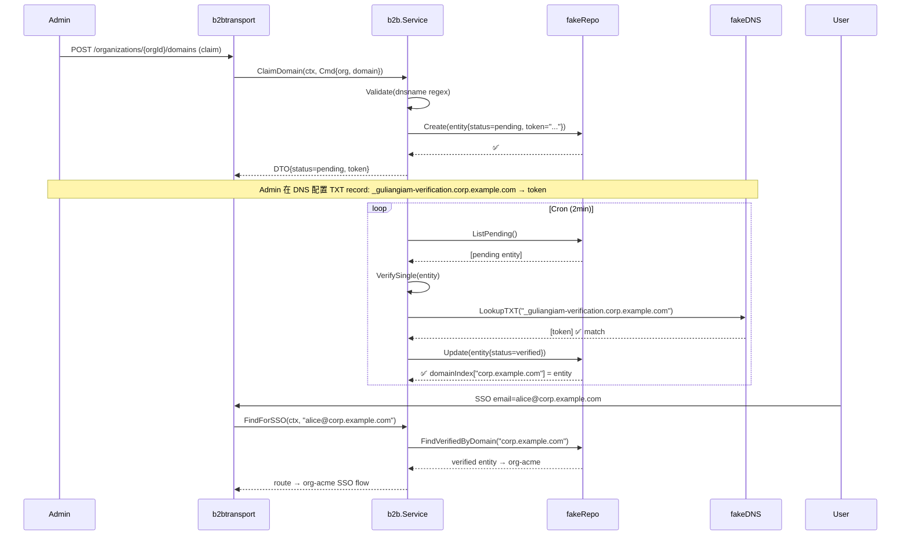

# layers — 分层架构 + 依赖规则 + 技术栈 + 模块边界

> 本文件是分层架构、依赖规则、技术栈、状态存储决策与模块边界的目标态规范，遵循 [docs/README.md](../README.md) 写作红线。

## 1. Clean Architecture 分层

```
┌─────────────────────────────────────────────┐
│                 Bootstrap                    │  Composition root
│  (runtime.go, chi.go, migrations)           │  Wires all layers together
├─────────────────────────────────────────────┤
│              Transport (HTTP)                │
│  internal/transport/http/                    │
│  ├── api/v1/{module}/ (handlers + routes)   │
│  │   每个资源域: chi.go(orchestrator)        │
│  │   + routes.go(route.Definition 声明)     │
│  └── middleware/ (auth, csrf, rate, waf)     │
│  Depends on: App, Platform                   │
├─────────────────────────────────────────────┤
│              Application                     │
│  internal/app/{module}/                      │
│  Business orchestration, input validation    │
│  Depends on: Domain, Platform                │
├─────────────────────────────────────────────┤
│              Domain                          │
│  internal/domain/{module}/                   │
│  Entities, value objects, repository         │
│  interfaces (pure business logic)            │
│  Depends on: Platform (clock/uuid only)      │
├─────────────────────────────────────────────┤
│              Infrastructure                  │
│  internal/infra/                             │
│  ├── postgres/{module}/  (PG 基线实现)       │
│  ├── mysql/{module}/     (MySQL 镜像实现)     │
│  └── dialect/            (多方言能力探测)     │
│  Depends on: Domain (implements interfaces)  │
├─────────────────────────────────────────────┤
│              Platform                        │
│  internal/platform/                          │
│  Cross-cutting: uuid, clock, errors,         │
│  middleware, logging, config, crypto          │
│  Depends on: Domain (port interfaces only)   │
└─────────────────────────────────────────────┘
```

### 1.1 依赖规则（严格）

| Layer     | May Import            | Must NOT Import               |
| --------- | --------------------- | ----------------------------- |
| Transport | App, Platform, Infra  | Domain（应走 App 层）          |
| App       | Domain, Platform      | Transport, Infra              |
| Domain    | Platform (clock/uuid) | App, Transport, Infra         |
| Infra     | Domain, Platform      | App, Transport                |
| Platform  | Domain（仅端口接口/实体，供横切组件引用；`check-layers.sh` Rule 7 裁决 platform→domain 为合法方向） | App, Transport, Infra, Bootstrap |
| Bootstrap | All layers            | 禁止被任何非 Bootstrap 包 import |

> **Transport → Infra 依赖约束**：Transport 不得直接 import `internal/infra/**` 或 `internal/domain/**`；基础设施能力经 App 用例或 domain 端口调用，由 Bootstrap 注入。

**验证方式**：违规由 `scripts/check-layers.sh` 阻塞；App 层对 Infra 层直接引用应保持为 0。解耦方式为 domain 端口接口 + infra 适配器实现，所有依赖通过 Bootstrap 构造函数注入。

**SQL 放置边界**（AGENTS.md 不变量 2）：业务 SQL 只在 `internal/infra/**`（postgres/mysql 仓储与适配器）。`internal/platform/` 的三个维护作业包豁免——`platform/db`（迁移执行/RLS 注入/连接治理）、`platform/outbox`（Outbox 投递账本）、`platform/crypto`（密钥轮换重加密/ provider 回填作业）；豁免仅限这些横切设施自身的维护语句，不得承载业务查询。`app/transport/domain` 非测试代码的 SQL 语句字符串字面量基线为 0，由 `check-layers.sh` Rule 10 阻塞固化（注释中的 SQL 说明不命中）。

## 2. 技术栈

| Component         | Technology                   | 事实源                                   |
| ----------------- | ---------------------------- | ------------------------------------- |
| Backend Language  | Go                           | 见 `go.mod` + 复现：`grep '^go ' go.mod`  |
| HTTP Framework    | chi/v5                       | 见 `go.mod`                            |
| Database Driver   | pgx/v5                       | 见 `go.mod`                            |
| Database          | PostgreSQL                   | CI 验证 18；生产版本见迁移/CI 支持矩阵              |
| Authorization     | Casbin                       | 见 `go.mod`                            |
| Password Hashing  | argon2id                     | 见 `go.mod`（`alexedwards/argon2id`）    |
| Frontend          | React                        | 见 `web/package.json`                  |
| UI Framework      | Ant Design                   | 见 `web/package.json`                  |
| State (Server)    | TanStack Query               | 见 `web/package.json`                  |
| State (Client)    | Zustand                      | 见 `web/package.json`                  |
| Routing           | React Router                 | 见 `web/package.json`                  |
| Build             | Vite + Rolldown              | 见 `web/package.json`                  |
| Schema Validation | Zod                          | 见 `web/package.json`                  |
| i18n              | i18next + react-i18next      | 见 `web/package.json`                  |
| E2E Testing       | Cypress（主）/ Playwright（部分场景） | 见 `web/package.json`                  |
| Lint / Format     | oxlint / oxfmt               | 见 `web/package.json`（devDependencies） |

## 3. 状态分类与存储决策

| 状态                        | 权威存储                    | 可选缓存               | 一致性要求            |
| ------------------------- | ----------------------- | ------------------ | ---------------- |
| 用户、组织、应用、角色、策略            | PostgreSQL              | 只读缓存               | 写入强一致并审计         |
| 授权码、设备码、Nonce、CAS Ticket  | PostgreSQL              | 短 TTL 缓存           | 原子消费、禁止重放        |
| Session、Refresh Token     | PostgreSQL              | Redis              | 吊销和重用检测不可丢失      |
| JWKS、Provider 元数据         | PostgreSQL/密钥服务         | Redis/本地缓存         | 版本化失效            |
| 限流计数和临时挑战                 | Redis 8（目标）             | TTL                | 超时和异常默认拒绝高风险操作   |
| Webhook、通知、同步任务           | PostgreSQL Outbox       | 队列/Worker          | 至少一次投递、消费幂等      |
| 关系元组（ReBAC）               | PostgreSQL              | 本地快照缓存 + Zookie    | 写后读一致性；未注册命名空间拒绝 |
| Workload 身份（SA/联邦信任/短期凭据） | PostgreSQL              | Redis（JWKS 缓存，可重建） | 信任配置变更双审；吊销即时生效  |
| 计量事件                      | PostgreSQL Outbox → 聚合表 | —                  | 幂等键防重；写入失败不阻塞主链路 |

### 3.1 Identity Warehouse 映射

| 概念      | 本项目实际存储                                                                               | 备注                                                   |
| ------- | ------------------------------------------------------------------------------------- | ---------------------------------------------------- |
| 身份记录    | `users`、`user_profiles`                                                               | `users` 只存身份主数据；凭据（密码哈希等）独立存 `user_credentials`，列清单见 `contracts/schema/20_identity.yaml` |
| 凭据      | `user_credentials`、`user_password_history`、`applications.client_secret_hash`          | 哈希边界见《开发规范手册》                                        |
| 组织与角色授权 | `organizations`、`roles`、`user_role_bindings`、`permissions`、`enforcers`、`casbin_rules` | 策略事实源只有 `casbin_rules` 一张表                           |
| 会话与令牌   | `sessions`、`access_tokens`、`refresh_tokens`                                           | `sessions.session_state` 为会话状态机字段（ADR-013）           |
| 策略点与模型  | `models`（Casbin 模型文本）、`adapters`（策略适配器）                                               | 由 `internal/infra/casbin.Manager` 装配                 |
| 外部身份映射  | `providers`、`ldaps`、`syncers`、`agents`                                                | 外部 IdP 绑定与目录同步                                       |
| 审计事实    | `records`                                                                             | 含 `surface`/`request_id`/`trace_id` 与哈希链目标列（ADR-031） |

> **红线**：对标讨论中不得引入本仓库不存在的表名（如 `identities`、`credentials`、`casbin_policies`、`policy_rules`）。`casbin_rules` 落库表名只有一个。

## 4. 推荐工具与采用边界

| 能力       | 推荐工具                                         | 采用边界                                   |
| -------- | -------------------------------------------- | -------------------------------------- |
| 分布式缓存/限流 | Redis 8+                                     | 不能成为用户和授权状态的唯一事实源                      |
| 根密钥管理    | Vault、AWS KMS 或 Azure Key Vault              | 生产根密钥不放 `.env`，应用只获取短期解包密钥             |
| 数据库访问    | pgx/v5 + 参数化 SQL                             | 动态排序、列名和 SCIM 字段必须白名单                  |
| 事件可靠性    | PostgreSQL Outbox + 幂等键                      | 不直接在事务中同步调用邮件、Webhook 和支付渠道            |
| API 契约   | OpenAPI 3.1 + `scripts/gen_openapi.py` 零差异门禁 | 路由、Schema、错误码必须同源更新                    |
| 观测       | OpenTelemetry + Prometheus + 结构化日志           | `request_id`、`trace_id`、`audit_id` 可关联 |

## 5. 授权决策顺序

```text
认证身份 → 解析组织 → 校验资源归属 → 计算 RBAC/ABAC 策略 → 执行动作 → 写审计事件
```

Casbin 只负责策略执行，不负责替代租户隔离。身份、组织、资源、动作和环境属性由应用层构造；策略引擎异常、策略来源不可用或租户无法确定时必须 fail-close。

### 5.1 PDP / PEP / PIP 映射

| 角色             | 本项目实现                                                            | 装配位置                                                       | 说明                                                    |
| -------------- | ---------------------------------------------------------------- | ---------------------------------------------------------- | ----------------------------------------------------- |
| **PEP**（策略执行点） | `internal/transport/http/api/v1/auth.APIAuthorizationMiddleware` | 由 `bootstrap/chi.go` 挂进 `protected` 链                      | 实现唯一；fail-close（《security-model》§8）；白名单精确到「方法 + 路径模板」 |
| **PDP**（策略决策点） | `internal/infra/casbin.Manager`                                  | `internal/infra/casbin/manager.go`                         | 每个组织一个 enforcer 实例；策略数据来自 `casbin_rules` 表            |
| **PIP**（策略信息点） | `internal/domain/permissions.CasbinPolicyManager` 等              | `internal/domain/permissions/`、`internal/app/permissions/` | 策略与属性的来源集合                                            |

> **红线**：Casbin 只做策略执行，**不得**用于替代租户隔离（`TenantFilterMiddleware` + RLS，ADR-016）、字段级权限（API 响应过滤）或数据行级过滤。

### 5.2 RBAC / ABAC / ReBAC 三引擎分工

| 引擎               | 职责范围                                           | 求值输入                                      | 输出                        |
| ---------------- | ---------------------------------------------- | ----------------------------------------- | ------------------------- |
| **RBAC（Casbin）** | 平台/租户级粗粒度「主体→角色→资源类型→动作」策略                     | 主体角色绑定、`casbin_rules`                     | allow/deny                |
| **ABAC**         | 属性驱动的策略求值：主体属性、资源属性、环境属性                       | 三类属性目录 + 环境属性（中间件注入）                      | 属性布尔表达式结果                 |
| **ReBAC**        | 对象级细粒度共享与层级继承：关系元组、对象树继承、组嵌套、Zookie 一致性、Why 溯源 | `relation_tuples` + `relation_namespaces` | allow/deny + 一致性令牌 + 展开链路 |

**决策顺序与回退**：

1. 先跑 Casbin RBAC 求值
2. 若声明对象级资源类型，Casbin allow 后叠加 ReBAC check
3. ReBAC 引擎不可用时按 fail-close 返回 503（不回退 Casbin allow），响应头携带 `Retry-After: 30`
4. 任何授权异常一律 fail-close

> **边界声明**：ReBAC 不接管租户隔离与字段级权限；ReBAC 的 `object` 命名含租户归属，但租户边界强制不依赖 ReBAC 求值正确性。

## 6. 领域模块

平台领域模块按功能类别组织，包清单一律以 `internal/domain/` 目录枚举为准，不在本文书写包计数与类别计数。以下是模块类别与职责概述：

| 类别                    | 主要模块（复现命令：`ls internal/domain/`）                                                                           | 职责                                               |
| --------------------- | ---------------------------------------------------------------------------------------------------------- | ------------------------------------------------ |
| Auth Core             | auth、lockoutattempts、webauthn                                                                              | 认证流程编排、账户锁定、WebAuthn 凭证                          |
| IAM Core              | users、organizations、applications、providers、roles、permissions、groups、sessions、tokens、authorizationcodes     | 用户/组织/应用/Provider/RBAC/会话/令牌                     |
| Authentication        | mfachallenges、qrcodesessions、deviceauthcodes、web3nonces、faceidsessions、castickets、kerberostickets、consents | MFA/二维码/设备流/Passkey/CAS/Kerberos/OAuth Consent      |
| Identity Verification | verifications、idv、captchaproviders、faceidproviders                                                         | 邮箱/手机验证、身份核验、CAPTCHA                             |
| Infrastructure        | certs、keys、webhooks、ldaps、syncers、agents、forms                                                             | 证书、密钥、Webhook、LDAP、同步                            |
| Authorization         | models、adapters、enforcers                                                                                  | Casbin 模型、适配器、Enforcer                           |
| Commerce              | products、orders、payments、plans、pricings、subscriptions、coupons、tickets、transactions                         | 商业产品/订单/支付/订阅                                    |
| Networking            | gateway、radiusconfigs、radiusaccountings                                                                    | API 网关、RADIUS                                    |
| Security              | rules                                                                                                      | 安全规则定义                                           |
| Audit and Monitoring  | records、entries                                                                                            | 审计记录、系统日志                                        |
| System                | resources、invitations、notifications、notificationproviders                                                  | 系统资源、邀请、通知                                       |
| AI/MCP                | mcpservers                                                                                                 | MCP 服务器管理                                        |
| AI 网关                 | aigateway、agents、mcpservers                                                                                | LLM 供应商管理、多协议面网关、MCP tool\_use                   |
| Protocol              | scim                                                                                                       | SCIM v2 用户/组供应                                   |
| **扩展域**               | rebac、risk、iga、b2b、workload、cross\_tenant\_operations、platform\_admins、aigateway                           | 对象级授权、风险引擎、身份治理、B2B 域治理、工作负载身份、跨租户授权、平台管理员、AI 网关 |

## 7. 模块解耦

App 层对 Infra 层不得直接引用；跨层协作一律通过 domain 端口接口 + infra 适配器实现，依赖由 Bootstrap 构造函数注入（分层规则见 §1.1，违规由 `scripts/check-layers.sh` 阻塞）：

| App Module             | Infra Dependency                               | Domain Port Interface                                | Adapter Implementation                         |
| ---------------------- | ---------------------------------------------- | ---------------------------------------------------- | ---------------------------------------------- |
| `app/permissions`      | `infra/casbin`                                 | `domain/permissions.CasbinPolicyManager`             | `infra/casbin.Manager`                         |
| `app/webhooks`         | `infra/notification`                           | `domain/webhooks.DeliverySender`                     | infra HTTP delivery adapter                    |
| `app/auth`             | `infra/jwt`, `infra/notification`, `infra/idv` | `domain/tokens.TokenIssuer` + `domain/auth.JWKSProvider` | `infra/jwt` adapter implementations            |
| `app/ldaps`            | `infra/ldap`, `infra/syncer`                   | `domain/ldaps.Repository` / `LDAPTestClient` / `LDAPSyncer` / `SyncScheduler` | `infra/ldap` client/syncer adapters            |
| `app/verifications`    | `infra/messaging`                              | `domain/verifications.SenderFactory`                 | `infra/messaging` adapter                      |
| `app/resources`        | `infra/storage`                                | `domain/resources.StorageProvider`                   | `infra/storage` adapter                        |
| `app/roles`            | `infra/casbin`                                 | `domain/roles.PolicyManager`                         | `infra/casbin` adapter                         |
| `app/certs`            | `infra/cert`                                   | `domain/certs.CertificateRenewer`                    | `infra/cert` adapter                           |
| `transport/middleware` | `infra/casbin`                                 | `middleware.CasbinEnforcer`                          | interface injection                            |
| `app/rebac`            | `infra/postgres/rebac`、`infra/mysql/rebac`     | `domain/rebac.Evaluator` / `domain/rebac.TupleStore` | `infra/postgres/rebac`、`infra/mysql/rebac` 适配器 |
| `app/iga`              | `infra/postgres/iga`、`infra/mysql/iga`         | `domain/iga.Repository`                              | `infra/postgres/iga`、`infra/mysql/iga` 适配器     |

## 7.1 模块边界收敛要求（目标态）

本节每一条都是**目标态硬要求**，由 `scripts/check-layers.sh` 与 CI 门禁阻塞；「验证」列给出可直接复现的判据。

| #   | 要求              | 内容                                                                                                                          | 验证                                                                                                                                                |
| --- | --------------- | --------------------------------------------------------------------------------------------------------------------------- | ------------------------------------------------------------------------------------------------------------------------------------------------- |
| B1  | 依赖方向单向          | Transport → App → Domain；Infra 实现 Domain 端口；Platform 仅引用 Domain 端口接口，不依赖 App/Infra/Transport                                     | `bash scripts/check-layers.sh`                                                                                                                    |
| B2  | Platform 边界纯净   | `internal/platform/**` 不得 import `app`/`infra`/`transport`；platform→domain 端口接口为合法方向（Rule 7 裁决）；跨层共享的路由常量、UoW 接口、SQL 方言接口必须归属 platform 或 domain 端口 | `grep -rnE '"github.com/guliangiam/guliangiam/internal/(app\|infra\|transport)/' internal/platform/ --include='*.go' \| grep -v _test.go` → 0 |
| B3  | UoW 接口归属 domain | `UnitOfWork` 接口定义在 `internal/domain/uow`；`internal/app/uow` 只保留 app 层组合逻辑（capability 拆分，单文件 ≤ §8.3 阈值）                      | `ls internal/domain/uow/`                                                                                                                         |
| B4  | 方言能力接口化         | SQL 方言能力以接口暴露（`internal/infra/dialect`），由 Bootstrap 注入实现，禁止调用方感知方言分支                                                        | `ls internal/infra/dialect/`                                                                                                                      |
| B5  | Infra 不得依赖 App  | 读侧投影 DTO 与查询接口归属 `internal/domain/<域>`（如 `internal/domain/dashboard`）                                                       | `grep -rnE '"github\.com/guliangiam/guliangiam/internal/app/' internal/infra/ --include='*.go' \| grep -v _test.go \| grep -v '/uow/uow.go'` → 0 |
| B6  | 文件体量阈值          | 非生成、非测试 Go 文件遵守 §8.3 阈值，超限按关注点拆分（登录按阶段、DI 按 `wire_*.go`、UoW 按 capability）                                                   | §8.3 复现命令                                                                                                                                         |
| B7  | 环境变量唯一入口        | 运行期配置只经 `internal/platform/config/env_core.go` 读取                                                                                | `grep -rn 'os\.Getenv' internal/ --include='*.go' \| grep -v _test.go \| grep -v config \| grep -v bootstrap \| grep -v migrate` → 0              |
| B8  | 方言镜像一致          | 同一能力在 PostgreSQL / MySQL 双方言实现同一接口、同一语义（如 DPoP jti 重放检测）；镜像仓储 SQL 必须在真实 MySQL + 生成 DDL 上通过运行期用例，编译通过不等于可用；不可用能力按 ADR-023 拒绝启动或返回能力不支持 | `ls internal/infra/postgres/dpop/ internal/infra/mysql/dpop/`；`MYSQL_DSN=... go test ./internal/infra/mysql/... -run Integration` |
| B9  | 写路径审计嵌入         | 每个业务 app 包提供 `audit_outbox.go`：业务写入、审计记录与 Outbox 事件同事务提交                                                                    | `ls internal/app/*/audit_outbox.go`                                                                                                               |
| B10 | 前端路径常量唯一        | 生产代码不得出现 `/api/v1/` 字面量；唯一常量源为 `web/src/shared/api/paths.ts`                                                                | CI `paths.ts gate`                                                                                                                                |
| B11 | 关联字段交互          | 关联选择字段一律用 Select 组件，禁止裸 Input；展示用可读名、内部值用 ID                                                                                | [design/frontend/interaction.md](../design/frontend/interaction.md)                                                                               |

***

## 8 分层合规与质量门禁

> 本章给出**门禁判据与复现命令**；本文不复写任何测量结果（用例数、覆盖率、扫描计数、依赖条目数），一律以命令输出为准。

### 8.1 代码量（按事实源查询，不手写计数）

代码行数与测试/生产比为**可生成事实**，本文不复写，按命令查询：

| 分类 | 路径 | 复现命令 |
| :-------- | :---------------------- | --------- |
| 后端 · 生产代码 | `internal/**/*.go`（非测试） | `find internal -name '*.go' ! -name '*_test.go' \| xargs wc -l \| tail -1` |
| 后端 · 测试代码 | `internal/**/*_test.go` | `find internal -name '*_test.go' \| xargs wc -l \| tail -1` |
| 前端 | `web/src/**/*.ts(x)` | `find web/src ( -name '*.ts' -o -name '*.tsx' ) \| xargs wc -l \| tail -1` |

### 8.2 分层合规性（Clean Architecture）

#### 8.2.1 包/文件数量分布（按事实源查询）

各层包与文件数为**可生成事实**，本文不复写，清单以目录枚举为准：

| 层              | 路径                                | 复现命令                                                  |
| -------------- | --------------------------------- | ----------------------------------------------------- |
| Domain         | `internal/domain/`                | `ls -d internal/domain/*/`                            |
| Application    | `internal/app/`                   | `find internal/app -maxdepth 2 -name 'service.go' \| wc -l` |
| Infrastructure | `internal/infra/`                 | `find internal/infra -maxdepth 2 -type d`             |
| Transport      | `internal/transport/http/api/v1/` | `find internal/transport/http/api/v1 -name 'chi*.go'` |
| Platform       | `internal/platform/`              | 横切关注点                                                 |

#### 8.2.2 跨层依赖门禁（`scripts/check-layers.sh`）

门禁规则清单与阻塞行为以 `scripts/check-layers.sh` 实际实现为准（复现：`grep -n 'Rule ' scripts/check-layers.sh`），本文不复写规则计数。Rule 1–5、9 为阻塞判定（违规计入退出码）；Rule 6/7/8 仅报告计数（informational，不计入退出码），收敛目标为 0 违规。Bootstrap 包反向依赖不在脚本判定范围；新增规则必须先 `scripts/check-layers.sh` 与 AC-ARCH-001 同步落地，再更新本表。

| Rule | 层→层检查                                 | 判定                        |
| ---- | ------------------------------------- | ------------------------- |
| 1    | App → Infra 穿透                        | 阻塞：必须 0                   |
| 2    | Transport → Domain / Infra 穿透         | 阻塞：必须 0                   |
| 3    | Domain → Infra/App 反向                 | 阻塞：必须 0                   |
| 4    | `fmt.Errorf` 未用 `%w` 包装               | 阻塞：必须 0                   |
| 5    | stdlib `log.*` 调用                     | 阻塞：必须 0                   |
| 6    | `TODO(phase3)` 待解耦标记                  | 报告计数（不计退出码）；收敛目标 0        |
| 7    | Platform → App/Infra/Transport（platform→domain 端口引用为合法方向，不计违规） | informational（不计退出码）；收敛目标 0，见 §7.1 B2 |
| 8    | Infra → App 反向（`*/uow/uow.go` 为设计例外）   | informational（不计退出码）；收敛目标 0，见 §7.1 B5 |
| 9    | `superAdminCtx` 回潮                   | 阻塞：必须 0                   |

##### 复现命令

```bash
# 完整规则扫描
bash scripts/check-layers.sh

# Rule 7：Platform → App/Infra/Transport（domain 端口引用合法，不在模式内）
grep -rnE '"github\.com/guliangiam/guliangiam/internal/(app|infra|transport)/' internal/platform/ --include='*.go' | grep -v _test.go

# Rule 8：Infra → App（`*/uow/uow.go` 为设计例外）
grep -rnE '"github\.com/guliangiam/guliangiam/internal/app/' internal/infra/ --include='*.go' | grep -v _test.go | grep -v '/uow/uow.go'

# Rule 2：Transport → Domain / Infra 穿透
grep -rnE '"github\.com/guliangiam/guliangiam/internal/(domain|infra)/' internal/transport/ --include='*.go' | grep -v _test.go
```

#### 8.2.3 Transport → Infra 穿透判定

Transport 不得直接 import `internal/infra/**` 或 `internal/domain/**`，判定必须 0 处。协议适配器同样不豁免：需要基础设施能力时，在 transport 包内定义本地接口或引用 domain 端口，由 Bootstrap 注入实现；确需新增穿透时必须先走架构评审，不得以文档例外清单放行。

**复现命令**：

```bash
grep -rnE '"github\.com/guliangiam/guliangiam/internal/(domain|infra)/' internal/transport/ --include='*.go' | grep -v _test.go
```

> 判定口径：输出 0 行即通过；新增行视为分层违规，由架构评审处理。

### 8.3 文件体量阈值

| 分类       | 阈值               | 处置                    |
| -------- | ---------------- | --------------------- |
| 单文件行数    | 目标 ≤ 600 行       | 超出即按关注点拆分为 cluster 文件 |
| God File | > 900 行（非测试、非生成） | 阻塞合并：必须拆分             |

**复现命令**：

```bash
find internal -name '*.go' ! -name '*_test.go' ! -path '*/generated/*' | xargs wc -l | sort -rn | head -20
```

**判定口径**：超限清单以复现命令输出为准，不在文档手写计数或文件清单。>900 行（非测试、非生成）阻塞合并；601–900 行须在评审中给出拆分计划。生成物（`*/generated/*`）不计入。DI 组装根允许以「每个 `wire_*.go` 承载一个基础设施关注点」为拆分界，不以行数作为唯一目标。

### 8.4 测试与覆盖率门禁

用例总数、PASS/FAIL、包级覆盖率与无测试包清单一律以命令输出为准，本文不复写数值：

| 维度        | 复现命令                                                                               |
| --------- | ---------------------------------------------------------------------------------- |
| 用例总数      | `go test ./internal/... -v` 输出中 `grep -c '=== RUN'`                                |
| 包级覆盖率     | `go test ./internal/... -coverprofile=cover.out` + `go tool cover -func=cover.out` |
| 无测试包清单    | `go test ./internal/...` 输出中的 `[no test files]`                                    |
| 前端 e2e 场景 | `ls web/e2e`                                                                       |
| 前端单测      | `find web/src -name '*.test.ts' -o -name '*.test.tsx'`                             |

**分层覆盖要求**：

| 层                                                        | 要求                                                          |
| -------------------------------------------------------- | ----------------------------------------------------------- |
| app / domain / transport(presenter,handler) / middleware | 变更路径必须由同 PR 测试覆盖                                            |
| bootstrap `wire_*.go`                                    | 允许 0%（纯 DI 构造），由端到端测试兜底                                     |
| 事务外裸 `return err`                                        | 收敛为 `WrapInternal(f)`；transaction callback 内的 rollback 语义保留 |
| 安全敏感路径（DPoP 校验、nonce、错误封装）                               | 函数级 100% 覆盖                                                 |

覆盖率门禁阈值与实现见《GuliangIAM-开发规范》测试与覆盖率章节及 CI coverage gate。

#### 8.4.1 迁移脚本与回滚要求

| 维度         | 目标态要求                                                                                                  |
| ---------- | ------------------------------------------------------------------------------------------------------ |
| Schema 事实源 | 声明式 `contracts/schema/*.yaml` 为唯一事实源（ADR-022）；DDL、版本化迁移与回滚脚本均为生成产物                                     |
| Up 迁移      | 覆盖全量建表与增量变更，可追溯至声明式 Schema                                                                             |
| Down 迁移    | 每个版本化迁移必须同时提供 `V{n}__*__down.sql`（仓库不使用 Flyway；执行入口为 `cmd/migrate` + `guliangiam.schema_migrations` 账本）              |
| 事务保护       | up/down 均包裹在事务内（PostgreSQL `BEGIN/COMMIT`；MySQL 显式事务并临时关闭 `FOREIGN_KEY_CHECKS`），失败时全量回滚，不得留下半变更 schema |
| 漂移检测       | `bash scripts/check-migrations.sh` + `python3 scripts/check-schema-parity.py`                          |
| Seed       | `db/seeds/V{n}__*.sql` 与迁移同版本号                                                                         |

### 8.5 前端结构与技术栈事实源

#### 8.5.1 结构（按事实源查询）

| 指标             | 复现命令                                                            |
| -------------- | --------------------------------------------------------------- |
| 页面目录与页面组件      | `ls -d web/src/pages/*/`；`find web/src/pages -name '*Page.tsx'` |
| 共享 UI 组件       | `ls web/src/shared/ui`                                          |
| 关联字段 Select 组件 | `find web/src/shared/ui -maxdepth 1 -name '*Select.tsx'`        |
| 服务端状态使用面       | `grep -rl 'useQuery\|useMutation' web/src \| wc -l`             |
| 客户端状态使用面       | `grep -rl 'zustand' web/src \| wc -l`                           |
| 路径常量导出         | `grep -c '^export ' web/src/shared/api/paths.ts`                |

**交互简化要求**：组织 / 用户 / 应用 / 角色 / 分组 / 计划 / 产品 / 定价 / 订单等关联字段一律用 Select 组件；只有外部系统标识符（`externalId`、`accessKeyId`）与自由字符串（域名）允许 Input。

#### 8.5.2 技术栈（事实源 `web/package.json`）

前端依赖、版本与锁定值一律以 `web/package.json` 与锁文件为准（复现：`node -p "require('./web/package.json').dependencies"`），本文不复写版本号。

#### 8.5.3 路径常量唯一源与 Select 组件分层

`web/src/shared/api/paths.ts` 是路径常量的唯一来源：

```typescript
// 静态路径：字符串常量
export const USERS = "/api/v1/users";
// 动态路径：以函数形式导出（路径参数经 encodeURIComponent 编码）
export const AUTH_QRCODE_STATUS = (codeId: string) =>
  `/api/v1/auth/qrcode/${encodeURIComponent(codeId)}/status`;
```

CI 门禁 `paths.ts gate` 扫描全 `web/src` 生产代码，要求 `/api/v1/` 字面量为 0（豁免 `.test.*` / `generated/` / `paths.ts` / `e2e/`）。

Select 组件分层模式：

| 类型  | 基础实现                               | 适用场景                       |
| --- | ---------------------------------- | -------------------------- |
| 搜索型 | `AsyncSearchSelect.tsx`（搜索 + 懒加载）  | 关联字段默认形态                   |
| 分页型 | `PaginateSelect.tsx`（分页 + 搜索）      | 大型数据集（Role / User / Group） |
| 树型  | `GroupTreeSelect.tsx`              | 组织内层级分组                    |
| 枚举型 | CountryCode / Region / Affiliation | 封闭枚举字段                     |

**收敛要求**：分页型收敛为搜索型的分页 variant（统一 loader 接口）；树型与枚举型保持独立实现。

#### 8.5.4 字段显示与交互简化判据

| 规则                | 判据                                                                                        |
| ----------------- | ----------------------------------------------------------------------------------------- |
| 关联字段展示可读名，内部值用 ID | Select 组件的 `label` 取 `displayName`/`name`，`value` 取 `id`（`web/src/shared/ui/*Select.tsx`） |
| 可关联选择不得用自由输入      | Create/Edit 页 `name="*Id"` 为裸 `<Input>` 的命中数为 0                                           |
| 组件职责分离            | Select 组件经 props 透传 `value`/`onChange`，父组件不持有 fetch 逻辑                                    |
| 删除确认              | 统一 `Popconfirm`，高风险删除追加二次确认                                                               |
| 反馈                | 统一 `App.useApp()` 的 message/modal，禁止全局 `window` 调用                                        |

### 8.6 后端技术栈事实源

后端依赖与版本一律以 `go.mod` 为准（复现：`grep -E '^go ' go.mod`、`go list -m all \| wc -l`），本文不复写版本号与依赖条目数。

### 8.7 安全纵深要求（等保 2.0 对照）

| 等保 2.0 要求 | 强制控制                                    | 事实源 / 证据                                                                             |
| --------- | --------------------------------------- | ------------------------------------------------------------------------------------ |
| TLS 传输加密  | 生产强制 TLS，禁止明文降级                         | `internal/bootstrap/server.go`、`run.go`                                              |
| 行级安全（RLS） | 多租户表声明 `rls: true` + 租户谓词，PG 侧 FORCE 生效 | `contracts/schema/*.yaml` 的 `rls` / `rls_predicate` 声明                               |
| 安全审计      | 写路径同事务写审计记录 + 哈希链                       | `internal/platform/auditoutbox/`、`internal/app/records/`                             |
| 访问控制      | RBAC + ReBAC + 字段级过滤，异常 fail-close      | `internal/infra/casbin`、`internal/domain/rebac`、`internal/transport/http/middleware` |
| 输入校验      | WAF + CSRF + 限流 + 动态列名白名单               | `middleware/{waf,cors,service_ip_limit}.go`                                          |
| 令牌绑定      | DPoP（jti 重放检测）+ mTLS，双方言语义一致            | `internal/infra/{postgres,mysql}/dpop/`                                              |
| 密钥管理      | 根密钥外置（KMS/Vault），密钥版本化轮转                | ADR-009 / ADR-015                                                                    |
| 完整性校验     | ETag / HMAC 请求签名；密钥缺失时生产 fail-close     | `middleware/etag.go`、`internal/platform/config/validate.go`                          |

### 8.8 横切关注点职责

| 关注点              | 归属实现                                                    | 约束                                                 |
| ---------------- | ------------------------------------------------------- | -------------------------------------------------- |
| 日志               | slog（Go 内置）                                             | 全链路结构化，禁止 `fmt.Print`                              |
| 配置               | `internal/platform/config/env_core.go` + CI gate             | 唯一入口，禁止零散 `os.Getenv`                              |
| JWT              | `internal/infra/jwt/`                                   | 签发/校验指标独立埋点                                        |
| 指标               | `internal/platform/middleware/prometheus.go`            | 命名与标签契约见 [observability.md §4.1](observability.md) |
| 追踪               | OpenTelemetry（`bootstrap/telemetry.go`）                 | `request_id` / `trace_id` / `audit_id` 可关联         |
| 加密               | `internal/platform/crypto/` + `internal/infra/cert/`    | 轮转策略见 §8.7                                         |
| 限流               | `internal/platform/middleware/ratelimit.go`（主限流器，参数事实源 `contracts/registries/limits.yaml`）；`internal/transport/http/middleware/service_ip_limit.go` 为 transport 层局部限流 | Redis 异常时高风险操作 fail-close                          |
| CSRF             | `internal/platform/middleware/csrf.go`                    | 双提交 cookie                                         |
| WAF              | `middleware/waf.go`                                     | 边界输入校验                                             |
| 幂等               | `middleware/idempotency.go` + 幂等键存储                     | 写接口幂等优先于乐观锁（ADR-018）                               |
| 压缩 / 安全头 / IP 规则 | `middleware/{compression,security_headers,ip_rules}.go` | 统一在 `protected` 链生效                                |
| Outbox           | `internal/platform/outbox/`                             | 与业务写入同事务，见 §7.1 B9                                 |
| 后台 Worker 生命周期     | `context.Context` + `recover.SafeGo`                     | 所有长期运行 goroutine 必须接受外部 ctx 以支持优雅关闭；禁止 `go func(){ _ = w.Start() }()` 静默丢弃错误——必须 `SafeGo` 包裹 |

### 8.9 部署与交付

| 组件             | 实现                                                                  |
| -------------- | ------------------------------------------------------------------- |
| Docker Compose | `docker-compose.yml` + `docker-compose.national-db.yml`             |
| K8s            | `k8s.yaml`（部署就绪）                                                    |
| 镜像             | `Dockerfile`                                                        |
| CI/CD          | 流水线清单以 `.github/workflows/` 为准（复现：`ls .github/workflows/`），本文不复写计数 |
| CI 门禁          | go build / tsc / schema 一致性 / paths.ts / os.Getenv / 交互简化           |

### 8.10 分层合规目标

| 目标      | 判据                                                                                                                                                   |
| ------- | ---------------------------------------------------------------------------------------------------------------------------------------------------- |
| 依赖方向单向  | §8.2.2 全部规则 0 违规（阻塞判定以脚本退出码为准，informational 规则以收敛目标衡量）                                                                                                                                |
| 唯一事实源闭合 | 配置（`platform/config/env.go`）、路由面（`transport/http/route`）、Schema（`contracts/schema/*.yaml`）、前端路径（`web/src/shared/api/paths.ts`）四层各有唯一入口，并由 CI gate 阻塞 |
| 安全纵深完整  | §8.7 全部强制控制落地，回归由 §8.2.2 与安全扫描门禁阻塞                                                                                                                   |
| 版本跟随    | 版本以 `go.mod` / `web/package.json` 为准，升级策略见 §9.4                                                                                                      |
| 可复用模式   | 方言镜像（`internal/infra/{postgres,mysql}/<能力>`）、端口接口（`internal/domain/*/repository.go`）、AsyncSearchSelect 包装、DI 分关注点拆分（`bootstrap/wire_*.go`）           |

***

## 9 目标架构与演进触发条件

> 本章描述**目标架构基线**、技术选型依据与**条件触发的演进路径**；触发条件未命中前，维持目标形态不变。

### 9.1 目标架构基线

| 维度   | 目标态决策                                                      | 决策依据                                                      |
| ---- | ---------------------------------------------------------- | --------------------------------------------------------- |
| 架构风格 | 模块化单体 + Clean Architecture                                 | ADR-001；分层门禁见 §8.2.2                                      |
| 部署单元 | `guliangiam`（API，内置 Outbox Worker）+ PostgreSQL + Redis | `docker-compose.yml`、`internal/bootstrap/wire_outbox.go`    |
| K8s  | 多副本 Deployment + HPA + PDB + `/healthz` + `/readyz`        | §10.2                                                     |
| 异步通信 | Outbox 模式，`FOR UPDATE SKIP LOCKED` 保证多 Worker 安全           | ADR-008；`internal/platform/outbox/`                       |
| 消息队列 | 维持 Outbox（进程内或独立 Worker），暂不引入 Kafka                        | §9.2 触发条件                                                 |
| 多区域  | 单区域为主；跨区域为条件触发能力                                           | [multi-region.md](multi-region.md)                        |
| 缓存   | Redis 承载限流与可重建缓存，不作状态事实源                                   | §3                                                        |
| 密钥管理 | 根密钥外置 KMS/Vault，应用只获取短期解包密钥                                | ADR-009 / ADR-015                                         |
| 观测性  | slog 结构化日志 + OpenTelemetry + Prometheus                    | [observability.md](observability.md)                      |
| 租户隔离 | 声明式 Schema 的 RLS + 租户过滤中间件双层                               | ADR-016                                                   |
| 方言支持 | PostgreSQL 为基线，MySQL 为镜像方言（同接口同语义）                         | ADR-023                                                   |
| 前端   | 独立 Vite SPA + Ant Design；TanStack Query 承载服务端状态、Zustand 承载客户端状态；版本以 `web/package.json` 为准 | [design/frontend/README.md](../design/frontend/README.md)、`web/package.json` |

### 9.2 架构演进触发条件

| 维度            | 目标                | 触发条件              | 动作                                        |
| ------------- | ----------------- | ----------------- | ----------------------------------------- |
| 高可用           | 多副本 + 健康检查自动切流    | 生产部署计划            | Deployment replicas ≥ 2 + PDB             |
| Outbox Worker | 独立 Worker 进程      | Worker 积压告警       | K8s Deployment / systemd 独立扩缩             |
| Kafka         | 引入 Kafka + 独立事件总线 | 跨系统事件订阅 ≥ 5 个不同系统 | `platform/outbox` Kafka Bridge            |
| 多区域           | 跨区域部署（主从 + 就近读）   | 业务进入多法域           | [multi-region.md](multi-region.md) §4     |
| KMS/Vault     | 生产根密钥托管           | 等保 2.0 正式评测       | ADR-009 落地                                |
| 性能压测          | 独立第三方压测 + 容量基线    | 生产部署前             | [observability.md](observability.md) 基线口径 |
| 安全渗透          | 独立第三方渗透测试         | 生产部署前             | 零高危为通过判据                                  |
| 微服务           | 维持模块化单体           | §9.3 阈值命中         | 按契约拆分并保留共享库                               |

### 9.3 微服务演进触发阈值（决策边界）

**ADR-001 + multi-region §4 共同定义的拆分条件**：

| 阈值                        | 指标   | 触发时的动作            |
| ------------------------- | ---- | ----------------- |
| 单体进程 CPU > 70%（P99）连续 7 天 | 容量瓶颈 | 拆分认证面（Auth）→ 独立服务 |
| 跨模块变更 CI 时间 > 10 分钟       | 开发效率 | 按契约隔离 + 独立流水线     |
| 需要独立扩缩容的模块出现              | 运维成本 | 管理面 vs 认证面分别扩缩    |
| 外部事件消费者 > 5 个不同系统         | 事件风暴 | 引入 Kafka + 事件总线   |
| 跨法域部署合规要求                 | 合规   | 多区域 + 就近读副本       |

**未触发阈值前维持模块化单体** — 模块边界用 Go 包隔离 + Port interface 约束，已在 §8.2 验证合规。

### 9.4 质量标准与验收准则

| 维度    | 验收标准                                                     | 验证方式                                     |
| ----- | -------------------------------------------------------- | ---------------------------------------- |
| 构建门禁  | go build + tsc + schema + paths.ts + os.Getenv + 交互简化 全绿 | CI 阻塞合并                                  |
| 测试覆盖  | 后端用例数以 CI 覆盖率门槛为准 / 前端 e2e 以 `web/e2e/` spec 清单为准        | `go test ./internal/...` + Playwright    |
| 安全纵深  | 等保 2.0 基本要求 100% 覆盖                                      | 安全渗透测试 + RLS 覆盖率 + CSRF/WAF 开启           |
| 可观测性  | OTel 完整链路（Trace + Metric + Log）+ 健康检查                    | `bootstrap/telemetry.go` + `/healthz` 端点 |
| 唯一事实源 | env.go / route surface / schema YAML / paths.ts 四层闭合     | ci.yml 四道 gate                           |
| HA    | Pod restart 自动恢复 / Outbox 不丢事件                           | 故障注入测试                                   |

***

## 10 架构级风险控制要求

> 本章给出架构级风险的**强制控制要求与判据**；不登记现状三态，落地进度以门禁结果与 `contracts/registries/open-items.yaml` 为准。

### 10.1 可扩展性要求

目标形态为模块化单体；模块边界由 Go 包隔离 + Port interface 约束（§7.1，门禁 §8.2.2）。

```text
Phase 0: 模块化单体（目标形态）
  ├── Go 包边界隔离 + Port interface
  ├── RLS + 声明式 Schema
  └── §9.3 阈值未命中 → 不拆分

Phase 1: 独立 Outbox Worker
  ├── Worker 进程化（systemd/K8s）
  └── 与主进程解耦故障域

Phase 2: Kafka Bridge
  ├── Outbox → Kafka 桥接
  └── 事件总线就绪，消费者独立部署

Phase 3: 按需微服务
  ├── 仅当 §9.3 阈值命中时拆分 Auth 面
  └── 共享 domain + platform library
```

**约束**：拆分必须由 §9.3 的触发证据驱动；无触发证据的提前拆分本身即为架构债务。

### 10.2 HA 可靠性要求

| 维度            | 要求                                                   | 判据                                     |
| ------------- | ---------------------------------------------------- | -------------------------------------- |
| Pod 副本        | replicas ≥ 2 + PDB `minAvailable=1`                  | `k8s.yaml` + 故障注入演练                    |
| Outbox Worker | 服务进程内 Worker（H40 单轨，独立 worker 进程已退役）；多副本由 `FOR UPDATE SKIP LOCKED` 保证不重复 | `internal/bootstrap/wire_outbox.go`、`internal/platform/outbox/` |
| 数据库           | 主从 / 逻辑复制；跨区域时就近读副本                                  | RTO/RPO 分级以 `contracts/registries/dr.yaml` 为准；跨区域目标值在演练实测回填前不承诺（《multi-region》§3）                    |
| Redis         | Sentinel 或 Cluster                                   | 限流/缓存降级演练                              |
| 健康检查          | `/healthz`（liveness，公开）+ `/readyz`（DB ping，token 保护） | K8s liveness/readiness 探针              |
| 密钥缺失          | 生产环境启动即失败（fail-close）                                | `internal/platform/config/validate.go` |

### 10.3 技术栈债务控制

| 维度    | 控制要求                                                             |
| ----- | ---------------------------------------------------------------- |
| 版本跟随  | 版本以 `go.mod` / `web/package.json` 为准；major 升级必须走 ADR             |
| 镜像构建  | 生产多阶段构建 + 镜像扫描                                                   |
| CI/CD | 构建门禁覆盖 go build / tsc / schema 一致性 / paths.ts / os.Getenv / 交互简化 |

### 10.4 架构级风险控制

架构级风险、强制控制与关闭条件以 `contracts/registries/security-readiness.yaml` 与 `contracts/registries/open-items.yaml` 为唯一事实源；生产部署控制要求见 §10.1–§10.3。本文不复制风险矩阵。

### 10.5 端到端残余风险控制清单

| ID      | 风险                                          | Severity | Probability | 强制控制                                                            | 阶段 |
| ------- | ------------------------------------------- | -------- | ----------- | --------------------------------------------------------------- | -- |
| SEC-01  | 整数窄化溢出（`internal/app/actions/wasm_host.go`） | HIGH     | Medium      | 安全转换 + 越界拒绝；gosec G115 零 HIGH                                   | A  |
| SEC-02  | sha1/md5、Slowloris、绑定 `0.0.0.0`             | MEDIUM   | Low         | 哈希替换为 argon2id；设置 `ReadTimeout`；绑定地址由配置决定                       | A  |
| SEC-03  | 未处理 error（G104）                             | LOW      | Low         | 显式处理或 `_ = err` 并注释                                             | B  |
| PERF-01 | auth handler 全路径覆盖最薄                        | MEDIUM   | Medium      | 补 handler 层集成测试（jwt 签发 + session 缓存 + RateLimiter）              | A  |
| PERF-02 | Admin API P99 未独立处置                         | MEDIUM   | Medium      | Prometheus histogram + AlertManager rule（observability.md §4.2） | A  |
| PERF-03 | Casbin / JWT / Argon2id 无独立指标               | LOW      | Low         | 三个直方图与 bucket 对齐 NFR 阈值（observability.md §4.3）                  | A  |
| ARCH-01 | Platform → infra/app 残留                     | LOW      | Low         | §7.1 B2/B3/B4 收敛                                                | B  |
| ARCH-02 | 方法缺失时 nil panic                             | HIGH     | Low         | 方法缺失时统一返回 `NewUnimplemented`                                    | A  |
| ARCH-03 | 读侧 DTO / UoW 接口归属 app                       | MEDIUM   | Medium      | §7.1 B3/B5 收敛                                                   | A  |
| DATA-01 | 多 Worker 重复处理（缺 SKIP LOCKED）                | LOW      | Low         | 多 Worker 部署前加 `FOR UPDATE SKIP LOCKED`                          | C  |
| DATA-02 | 跨表引用缺 FK 兜底                                 | LOW      | Low         | 显式 FK + `ON DELETE CASCADE`（`contracts/schema/*.yaml`）          | A  |
| B2B-01  | 域名删除/校验缺归属权校验                               | MEDIUM   | Medium      | 服务端派生主体 + `GetByID` 后比对组织归属                                     | A  |
| B2B-02  | 路由未注册到统一入口                                  | MEDIUM   | Low         | `bootstrap/router.go` 统一调用各域 `RegisterChiRoutes()`              | A  |

***

## 11 需求覆盖与角色权限

### 11.1 需求 ↔ 设计 ↔ AC ↔ ADR 追溯

需求覆盖的唯一事实源是生成物 [traceability-matrix.md](../traceability-matrix.md)（由 `python3 scripts/gen_traceability.py` 产出，`--check` 零差异门禁）；覆盖缺口登记在 `contracts/registries/open-items.yaml`。**本文不复写模块覆盖度与 REQ 计数。**

需求编号与代码的双向追溯要求：核心服务函数顶部注释引用对应 `REQ-*` 编号（如 `// REQ-AUTH-001`），由评审把关。

### 11.2 角色权限

端点级权限点唯一事实源为 `route.Definition.Permission`（经 OpenAPI 生成器导出）；域级权限目录、角色与模块授予关系以 `contracts/registries/permissions.yaml` 为准。角色语义与 ReBAC 叠加关系见 [design/iam/roles.md](../design/iam/roles.md)。本文不复制权限矩阵与符号表。

### 11.3 B2B 域名治理端到端数据流（Mermaid 序列图）

```mermaid
sequenceDiagram
    participant Admin as 组织管理员
    participant FE as 管理控制台
    participant API as B2B Handler
    participant Svc as app/b2b.Service
    participant Repo as infrastructure repository
    participant DNS as DNS TXT 查询
    participant Cron as b2b_verify Worker
    participant SSO as Login 请求

    Note over Admin,FE: ============ 第一阶段：认领 ============
    Admin->>FE: 输入域名 example.com
    FE->>API: POST /organizations/{orgId}/domains
    API->>Svc: ClaimDomain(orgID, "example.com")
    Svc->>Svc: 生成 32-bit hex token
    Svc->>Repo: Create(organization_domain{domain, token, status=pending})
    Repo-->>Svc: 返回实体
    Svc-->>API: DomainDTO{verificationToken: "abc123..."}
    API-->>FE: 201 Created {token: "abc123...", host: "_guliangiam-verification.example.com"}
    FE-->>Admin: 显示 DNS 指引<br/>在 _guliangiam-verification.example.com TXT 记录添加<br/>abc123...

    Note over Cron,DNS: ============ 第二阶段：自动验证（Cron 2min ticker） ============
    loop 每 2 分钟
        Cron->>Svc: ListPending()
        Svc->>Repo: FindByStatus(pending)
        Repo-->>Svc: [domain{name:"example.com", token:"abc123..."}]
        Svc->>Repo: 逐个取出 domain
        Svc->>Svc: VerifySingle(domainEntity)
        Svc->>DNS: TXT 查询 _guliangiam-verification.example.com
        alt DNS 记录存在且 token 匹配
            DNS-->>Svc: "abc123..."
            Svc->>Repo: Update(status=verified, verified_at=now)
            Cron->>Cron: Prometheus Counter +1 (b2b_domain_verified_total)
        else DNS 记录缺失或 token 不匹配
            DNS-->>Svc: NXDOMAIN / 空结果 / 不同值
            Svc->>Repo: Update(status=failed)
            Cron->>Cron: Prometheus Counter +1 (b2b_domain_failed_total)
        end
    end

    Note over Admin,API: ============ 手动触发验证 ============
    Admin->>FE: 点击 "立即验证"
    FE->>API: POST /organizations/{orgId}/domains/{id}/verify
    API->>Svc: VerifyDomainByID(id) → GetByID + VerifySingle
    （后续走相同 VerifySingle → DNS → Update 路径）

    Note over SSO,Repo: ============ 第三阶段：SSO 邮箱域发现 ============
    SSO->>Svc: FindForSSO("user@example.com")
    Svc->>Svc: 提取 "example.com"
    Svc->>Repo: FindVerifiedByDomain("example.com")
    alt 存在 verified 记录
        Repo-->>Svc: {organization_id: "uuid-123"}
        Svc-->>SSO: SSO 登录流程路由到 org uuid-123
    else 不存在
        Repo-->>Svc: nil
        Svc-->>SSO: 普通登录流程
    end
```

## 12 工程规范索引

工程规范（Go / TypeScript / 前端 / 数据库 / API / 架构 / Git / 评审 / 测试 / 安全 / SLO / 可观测性 / 运维 / 密钥 / A11y / i18n）的唯一权威源是 [GuliangIAM-开发规范.md](../GuliangIAM-开发规范.md)。本章只保留架构层特有的约定，其余一律不在此重复。

### 12.1 Agent 层的架构约定

| 项    | 约定                                                               |
| ---- | ---------------------------------------------------------------- |
| 功能定位 | Agent 是 BFF / Tool 执行层——桥接用户意图与 IAM 核心服务                         |
| 接口   | Agent Handler 属于 transport 层；复用 `platform/http` 的响应与错误契约         |
| 通信协议 | HTTP JSON（OpenAPI 生成）+ 异步事件（`platform/outbox`）                   |
| 部署   | 与主服务同进程，无独立生命周期                                                  |
| 运维   | Prometheus 指标（`platform/telemetry`）+ OTel trace                  |
| 异常处理 | 统一 `platform/errors` → `platform/http.WriteError` → middleware；禁止裸 recover |

## 13 测试与端到端数据流

### 13.1 B2B 端到端测试数据流（§六 数据流闭环证据）



### 13.2 测试夹具规范

| 夹具                | 位置                   | 用途                                                      |
| ----------------- | -------------------- | ------------------------------------------------------- |
| fakeRepo          | `service_test.go` 同包 | Repository 接口 fake，维护 items + domainIndex + listPending |
| fakeDNSResolver   | 同上                   | DNS TXT 查找 fake，支持预置 token 或注入 lookup error             |
| stubUUIDGenerator | 同上                   | 预测 UUID 序列，断言 DTO.ID / VerificationToken                |
| clock.SystemClock | platform/clock       | 真实时间（固定时间用 `clock.FakeClock`）                           |

**Rule**：禁止 `gomock.NewController` 嵌套 fake struct（已弃用）；所有 fake 必须可独立实例化（`newFakeRepo()` 无外部依赖）。
