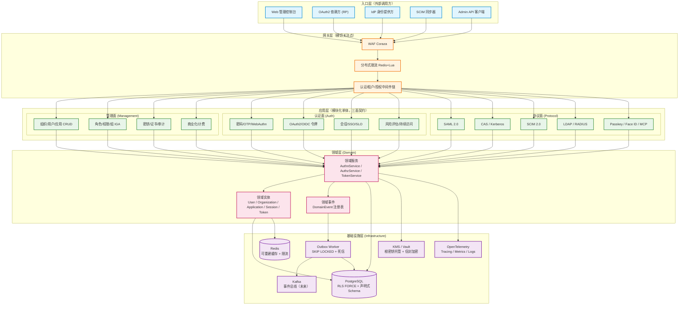

# system-overview — 系统概述 + 产品定位

> 目标态规范「system-overview — 系统概述 + 产品定位」；写作约束见 [docs/README.md](../README.md)。

## 1. 产品定位

GuliangIAM 是多租户身份与访问管理平台。系统以 PostgreSQL 为身份事实源，以 Redis 承载可重建缓存与限流，以 KMS/Vault 托管根密钥，以 Clean Architecture/DDD 约束后端依赖，以协议适配器承载 OAuth 2.1/OIDC、SAML、CAS、SCIM、LDAP、RADIUS、Kerberos 和 WebAuthn 等能力。

**总原则**：声明式模型驱动 + 契约优先 + 强一致事实源 + 事件化副作用 + 默认安全/默认拒绝。数据库、API、事件、错误码、权限点、状态机、环境变量都必须有唯一可执行事实源，并由生成器产出代码、DDL、OpenAPI、SDK、前端类型、测试与文档。

## 2. 整体架构图

GuliangIAM 采用模块化单体 + Clean Architecture 分层。以下架构图展示入口层 → 网关层 → 应用层（单体三面对外契约）→ 领域层 → 基础设施层的请求流向，以及 Outbox 异步投递旁路。

> **分层说明**：图中箭头为**运行时数据流向，不是 import 依赖方向**——领域层只定义端口接口，对 PostgreSQL/Redis/KMS 等的访问由 infra 适配器实现并经组合根注入（依赖规则见《layers》§1.1）。管理面/认证面/协议面是同一 Go 进程内按包边界隔离的契约分组（非独立部署单元）。所有写路径统一走 Outbox → Worker 异步投递，请求路径内禁止同步外呼。PostgreSQL 为身份事实源（RLS FORCE 双防线），Redis 仅作可重建缓存，KMS/Vault 托管根密钥。

## 3. 物理部署视图

控制面负责组织、用户、应用、Provider、策略、密钥、审计和管理 API；数据面负责登录、授权码、令牌、会话、JWKS 和协议元数据。**物理视图不按三面切分**——三面是同一进程内的契约分组（见《api-surfaces》），不是部署单元。第一阶段保持单体部署，但按包、数据库权限、限流、指标和故障处理隔离；只有容量和故障域证据充分时才拆分服务（触发阈值见《multi-region》§4），届时控制面映射到管理面、数据面映射到认证面 + 协议面。

## 4. 生产级 IAM 对齐能力

以下能力是对标生产级 IAM 的补齐项，决策见对应 ADR，设计细节见 [docs/design/](../design/README.md) 的对应子域文档，验收见 `acceptance-criteria.md`。能力建设状态以 ADR 索引为准，本节不声明完成态。

| 能力 | 关键设计 | 决策 |
|------|---------|------|
| Outbox 与幂等 Worker | 请求路径内禁同步外呼；Worker 领约（SKIP LOCKED）/指数退避/死信 | ADR-008 |
| KMS/Vault 根密钥托管 | 根密钥外置 KMS/Vault，禁止环境变量裸传长期主密钥 | ADR-009 |
| Redis 仅作可重建缓存 | 缓存缺失一律回源；不得因缓存不可用放行（fail-close） | ADR-010 |
| 高增长表时间分区 | TTL/归档/容量指标先行，凭 `EXPLAIN (ANALYZE, BUFFERS)` 证据启用 | ADR-011 |
| 会话状态机与固定/劫持防护 | 会话状态机 + 双超时 + 令牌哈希存储 | ADR-013 |
| 令牌绑定 | DPoP（nonce/jti 共享存储）/ mTLS（`cnf.x5t#S256`） | ADR-014 |
| 密钥版本与轮换 | `key_id`/`key_version` 信封 + 退役/销毁状态机 | ADR-015 |
| 多租户 RLS | `set_config(..., true)` 租户上下文 + RLS 兜底；TenantFilter 严格模式 | ADR-016 |
| 领域事件 | `DomainEvent` + 事件清单，不做事件溯源 | ADR-017 |
| 统一幂等 | `Idempotency-Key` + 请求哈希；幂等优先于乐观锁 | ADR-018 |
| 分布式限流 | Redis + Lua 令牌桶，故障时高风险操作保守拒绝 | ADR-019 |
| SLO 与可观测性 | SLI/SLO/错误预算 + 自适应采样 | ADR-020 |
| 环境标识与密钥变量语义统一 | `APP_ENV` 为唯一环境标识；会话 Cookie 不使用 HMAC 签名格式，不引入 `SESSION_HMAC_KEY` 类会话密钥变量（密钥变量语义边界见开放项 `OPEN-API-20`） | ADR-021 |
| 声明式 Schema 与版本化迁移 | 结构唯一事实源 + 生成器产出迁移/回滚 | ADR-022 |
| 多数据库方言抽象 | 受限 SQL 子集 + Dialect 接口 + 能力探测 | ADR-023 |
| ReBAC 对象级细粒度授权 | 关系元组 + Zookie 写后读一致性 + Why 溯源。落点：`internal/domain/rebac/evaluator.go` | ADR-024 |
| IGA JIT 访问生命周期 | 访问 Campaign + 时间窗 + 自动回收 | ADR-025 |
| Workload 身份联邦 | SA 一等主体 + OIDC 联邦信任 + 身份池 | ADR-026 |
| 自适应持续访问评估 | 风险信号 + 规则评分 + 会话治理。落点：`internal/app/risk/service.go` | ADR-027 |
| 多级组织域联邦 | 跨组织域身份与授权 | ADR-028 |
| Identity Actions 沙箱 | WASM 优先隔离 + 租户可编程扩展点 | ADR-029 |
| SCIM 出站 JML 供应 | 同步器 + JML 映射 | ADR-030 |
| 区域驻留 + 密码学 + 审计链 | 数据不出区域 + 审计哈希链锚定 | ADR-031 |

## 5. 设计不变量

以下 24 条是系统长期架构记忆的硬性不变量。每条均为「从零开始构建该系统」语境下的最优决策，落点见对应章节与 ADR；任何实现、重构或扩展不得突破这些约束：

1. 声明式 Schema 是唯一结构源（ADR-022）
2. 注册表驱动一切可枚举事实（contracts/registries/）
3. 路由声明是端点唯一源（ADR-012）
4. DTO/IDL 是字段契约源
5. 模块化单体 + 逻辑控制面/数据面（ADR-001）
6. 协议面单权威前缀，无兼容期
7. 所有写接口幂等优先于乐观锁（ADR-018）
8. 所有外部副作用走 Outbox/Worker（ADR-008）
9. 审计同事务 + 哈希链 + 锚定 + WORM（ADR-031）
10. 租户隔离双防线：严格模式 + RLS FORCE（ADR-016）
11. KMS/Vault + 信封版本化 + 无明文降级（ADR-009/015）
12. 默认拒绝；依赖不确定时一律 fail-close，由 `internal/transport/http/middleware/recover.go` 统一兜底（《security-model》§8）
13. 缓存只缓存可重建数据，吊销事件驱动失效（ADR-010）
14. 多方言能力探测，不降安全能力（ADR-023）
15. 分面 SLO + 错误预算（唯一口径见 contracts/registries/slo.yaml）
16. 命名注册表统一全仓拼写（contracts/registries/naming.yaml）
17. 文档不写生成事实
18. 数据分类与驻留先行（PRIV-010）
19. 性能容量三口径分离，全部以 L2 实测校准
20. 读取面契约自描述
21. 预览与执行同源
22. 写入即不可读
23. 前端状态与偏好收敛为单轨
24. 安全与完整性优先于可用性妥协

> 以上 24 条不变量是 GuliangIAM 长期架构锚定——任何实现、重构或扩展不得突破这些约束；每条的决策依据见 [docs/adr/](../adr/README.md) 对应 ADR，落点见各架构文档与 `contracts/registries/*.yaml`。
