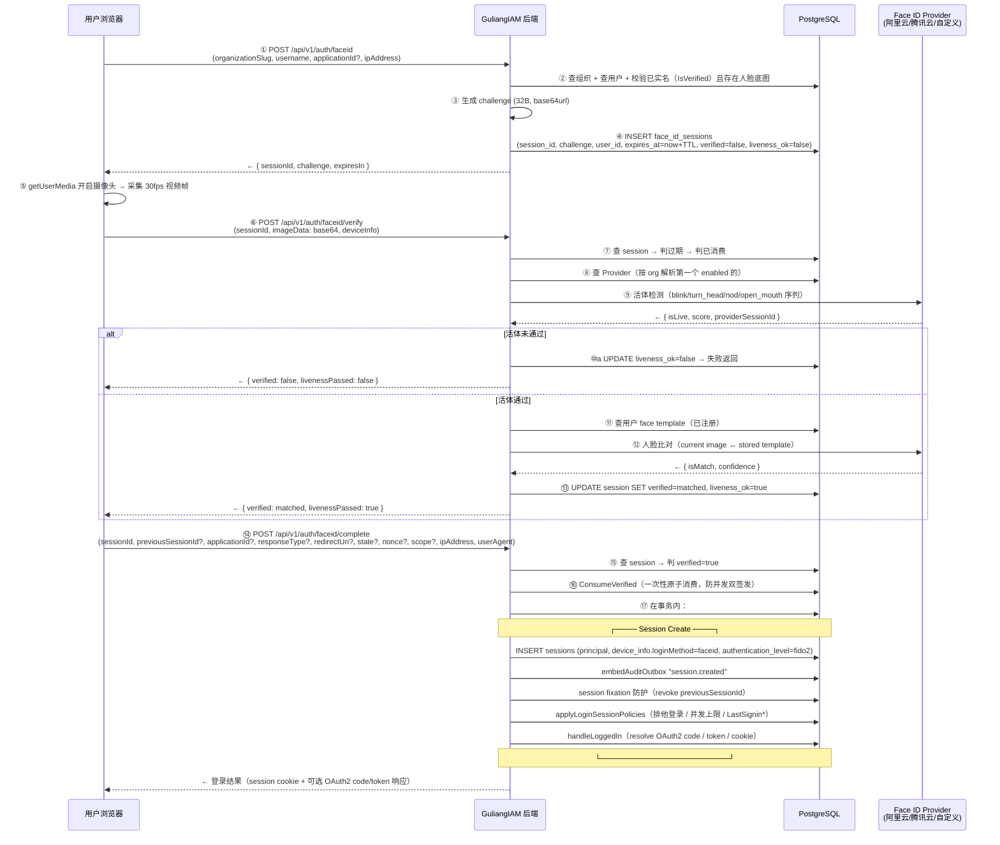

# Face ID 活体检测登录

> 设计锚点：[DESIGN:auth/faceid]

> 目标态规范「Face ID 活体检测登录」；写作约束见 [docs/README.md](../../README.md)。

---

## 1. 三步 Ceremony 完整规格

### 1.1 时序



### 1.2 Initiate 端点校验项

| # | 校验项 | 失败语义 |
|---|--------|---------|
| 1 | `organizationSlug` 非空 | 400 invalid_argument |
| 2 | `username` 非空 | 400 invalid_argument |
| 3 | 组织存在 | 404 not_found |
| 4 | 用户在该组织下存在 | 404 not_found |
| 5 | 用户已完成实名认证（`user.IsVerified == true`） | 401 unauthorized |
| 6 | 用户存在人脸底图：`FaceTemplates()` 仓储活跃行（加密引用）优先，存量 `face_ids` JSONB 的 `ImageUrl` 仅作迁移前回退（`getFaceTemplate`） | 401 unauthorized |

门控与 `user.MfaMethods` 无关：Face ID 是主登录凭证，底图注册闭环不写 `MfaMethods[faceid]`（见 §5.1；`internal/app/auth/faceid.go` 的 `InitiateFaceID`，复现：`grep -n 'IsVerified\|getFaceTemplate' internal/app/auth/faceid.go`）。

### 1.3 Verify 端点校验项

| # | 校验项 | 失败语义 |
|---|--------|---------|
| 1 | `sessionId` 非空 | 400 invalid_argument |
| 2 | session 存在 | 400 invalid_argument |
| 3 | session 未过期（`expires_at > now`）→ 过期则物理删除 | 400 invalid_argument |
| 4 | session 未已消费（`verified=false`） | 409 conflict |
| 5 | 该组织存在且启用了 Face ID Provider | 500 internal（unimplemented provider） |
| 6 | 活体检测结果 `isLive=true` 且 `score ≥ provider.config.liveness_threshold` | 业务失败（verified=false, livenessPassed=false） |
| 7 | 人脸比对结果 `isMatch=true` 且 `confidence ≥ provider.config.match_threshold` | 业务失败（verified=false） |

### 1.4 Complete 端点一次性消费

`ConsumeVerified(sessionID)` 是原子数据库操作：

```sql
DELETE FROM guliangiam.face_id_sessions
WHERE session_id = $1 AND verified = true;
-- 影响行数为 0 → 已消费 / 不存在 / 未验证 → 返回 conflict
```

**双门禁**：
1. `session.Verified == true` 是 `complete` 调用的前置条件（不满足 → 401 unauthorized）
2. `ConsumeVerified` 是签发 session/token 前的原子闸门（并发双 complete 只有一个能通过）

前置检查 → 原子消费 → 事务内签发，三步共同保证 **一次 face session 只产出一个登录结果**。

---

## 2. Face Session 状态与生命周期

### 2.1 数据模型

> 事实源：`contracts/schema/50_protocol.yaml`（`face_id_sessions` 表；复现：`grep -n 'face_id_sessions' contracts/schema/50_protocol.yaml`）。列、索引、约束与 RLS 以 Schema 为准（生成物复现：`python3 scripts/gen_schema.py --check`），本文不复制 DDL。

生命周期语义：

- `session_id` 是对外暴露的一次性句柄；`challenge` 为 32B base64url 随机值。
- `verified` / `liveness_ok` 分别标记人脸比对与活体检测通过；`attempt_count` 记录业务级 verify 次数，`verified=true` 必须至少 verify 过一次（CHECK 约束承载）。
- `expires_at` 承载 TTL；清理作业只扫未消费（`verified=false`）的过期行（部分索引承载）。
- 表启用 RLS，租户隔离按 ADR-016。

### 2.2 Provider 数据模型

> 事实源：`contracts/schema/20_identity.yaml`（`face_id_providers` 表，复现：`grep -n 'face_id_providers' contracts/schema/20_identity.yaml`）与 `internal/domain/faceidproviders/face_id_provider.go`；列与约束以 Schema 为准，本文不复制 DDL。

语义约束：

- 每组织可配置多个 Provider（组织内名称唯一），`provider_type` 区分 Aliyun / Tencent / Baidu / Custom / Local UniFace。
- `access_key_id` / `access_key_secret` 以 AES-256-GCM 字段加密存储（ADR-021），读接口不回显。
- `config`（JSONB）承载 `liveness_threshold`（≥0.85）与 `match_threshold`（≥0.95）等阈值。
- Verify 按组织解析第一个 enabled 的 Provider。

### 2.3 生命周期参数

| 参数 | 目标值 | 理由 |
|------|--------|------|
| Session TTL | **2 分钟** | 移动端弱网下一次采集 → verify 的典型链路需要更长窗口；需求 AUTH-062 已对齐 2 分钟（`faceIDSessionTTL`） |
| 最大 verify 次数 | **3 次** | 每次 verify 调用递增 `attempt_count`；超限时物理删除 session 并返回 **423 account_locked**，引导重新 Initiate（`faceIDMaxAttempts`） |
| 活体阈值 | ≥ 0.85 | `config.liveness_threshold`（按 0~1 分）；需求未定义默认值，由 Provider 配置承载 |
| 人脸比对阈值 | ≥ 0.95 | `config.match_threshold`（按 0~1 分）；需求未定义默认值，由 Provider 配置承载 |

常量复现：`grep -n 'faceIDSessionTTL\|faceIDMaxAttempts' internal/app/auth/faceid.go`。

### 2.4 清理作业

与 WebAuthn challenge 清理同节拍调用（见《design/auth/webauthn.md》Challenge 生命周期）。清理过期 `verified = false` 的 session，保留期 24h（审计追溯窗口）。

---

## 3. Provider SPI 适配器设计

### 3.1 适配点

`internal/app/auth/faceid.go` 提供函数变量（而非 Go interface）作为适配注入点：

```go
var faceIdVerifyLivenessFunc faceIdVerifyLivenessFuncType
var faceIdCompareFaceFunc    faceIdCompareFaceFuncType

func SetFaceIdAdapters(
    verifyLivenessFn faceIdVerifyLivenessFuncType,
    compareFaceFn    faceIdCompareFaceFuncType,
)
```

**SPI 签名**（定义类型，首参后含 `providerType`；`internal/app/auth/faceid.go`，复现：`grep -n 'faceIdVerifyLivenessFuncType\|faceIdCompareFaceFuncType' internal/app/auth/faceid.go`）：

```go
// 返回值：isLive, score (0~1), providerSessionId, error
type faceIdVerifyLivenessFuncType func(
    ctx context.Context,
    providerType, accessKeyID, accessKeySecret, endpoint string,
    imageData string, deviceInfo string,
) (isLive bool, score float64, sessionID string, err error)

// 返回值：isMatch, confidence (0~1), error
type faceIdCompareFaceFuncType func(
    ctx context.Context,
    providerType, accessKeyID, accessKeySecret, endpoint string,
    imageData string, storedTemplate string,
) (isMatch bool, confidence float64, err error)
```

未注入适配函数时，默认实现返回 `unimplemented`（fail-close，不静默放行）。

### 3.2 可选实现

| Provider | ProviderType | 活体检测 API | 比对 API |
|----------|-------------|-------------|---------|
| 阿里云 | `Aliyun` | Facebody 2.0 `DetectLivingFace` | Facebody 2.0 `CompareFace` |
| 腾讯云 | `Tencent` | `DetectLiveFace` | `CompareFace` |
| 百度云 | `Baidu` | `liveness` | `match` |
| 本地 Custom | `Custom` | 预置适配函数（测试用 / 自建） | 预置适配函数 |
| 本地 UniFace | `local_uniface` | 不提供；策略要求活体时返回 `unimplemented` | `/v1/compare` |

### 3.3 安全注意

- `access_key_secret` 通过 `AES-256-GCM` 字段加密存储（ADR-021 + 《security-model》§2.7），不回显到前端
- **App 编排 + Infra 适配器实现**：App 层（`internal/app/auth/faceid.go`）只做用例编排与错误分类（业务失败 vs 内部故障 vs 限流）；Provider 外部调用实体在 `internal/infra/faceid/`（`aliyun_verifier.go`、`local_uniface.go`、`verifier.go`），经 `bootstrap/runtime_providers.go` 的适配函数 → `wire_domains.go` 的 `SetFaceIdAdapters` 注入 App 函数变量
- Provider 外部调用**不发射专用审计事件**；登录通道审计收敛到注册表已登记事件（`user.login_succeeded`，`payload.method=faceid`，见 §5.4），事件集以 `contracts/registries/events.yaml` 为唯一事实源，不得在文档或代码虚构未登记事件

### 3.4 端口形式

Face ID Provider 的端口抽象按 [ADR-005](../../adr/ADR-005-port-interfaces.md) 的 Domain Interface 要求演进；跨 App 层复用与开放项以 `contracts/registries/open-items.yaml` 为准，本文不登记待决方案与实施位置。

---

## 4. 路由与鉴权矩阵

| 端点 | Method | 鉴权 | 限流 | 匿名可达 | 说明 |
|------|--------|------|------|---------|------|
| `/api/v1/auth/faceid` | POST | 匿名可达（username 在请求体；PEP 公开白名单） | `AuthRateLimit` + Provider 级叠加 | 是 | Initiate：验证 user 存在 + 已实名 + 存在底图 |
| `/api/v1/auth/faceid/verify` | POST | 匿名可达（PEP 公开白名单） | `AuthRateLimit` + 每 session 3 次业务限制 | 是 | 活体检测 + 比对 |
| `/api/v1/auth/faceid/complete` | POST | **不在匿名公开白名单**（见下） | `AuthRateLimit` | 否（运行期白名单口径） | 一次性消费 + 签发会话 |

**匿名可达性与 CSRF 是两道独立门**（事实源：`internal/transport/http/api/v1/auth/auth_paths.go` 与 `internal/platform/middleware/csrf.go`；复现：`grep -n 'faceid' internal/transport/http/api/v1/auth/auth_paths.go`）：

- PEP 公开白名单（`isAuthLoginFlowPublic`）只覆盖 `/api/v1/auth/faceid` 与 `/api/v1/auth/faceid/verify`；`faceid/complete` 不在任何公开白名单。匿名直调 complete 的链路：CSRF 双提交校验（无 cookie/header → 403）→ PEP 匿名 fail-close（401）。
- **三个端点均不在 CSRF 豁免清单**：豁免谓词只有「客户端认证协议端点精确 POST 清单（`clientAuthenticatedProtocolPaths`）」与「已验证 Bearer 会话」两类（《webauthn.md》§CSRF 豁免边界）。faceid 的 mutating 请求一律要求 `X-CSRF-Token` 双提交；浏览器匿名流程先经安全方法取得 csrf cookie 再提交。
- **安全裁决项**：设计意图上 complete 消费的是无 cookie 随行的一次性 face session 凭据（与 qrcode exchange、webauthn authentication/finish 同语义，后两者均在公开白名单内）；complete 的白名单覆盖与该意图的分歧须由安全流裁决后以代码或白名单变更收敛，本文只记录运行期白名单事实，不擅自变更安全语义。

**限流键**：

| 端点 | 限流键 | 理由 |
|------|--------|------|
| Initiate | client IP | 枚举用户名探测 |
| Verify | client IP + sessionId | 弱 session 枚举 |
| Complete | client IP | 一次性凭据滥用 |

**错误体**：认证面标准应用错误体三件套（`error.code / error.message / requestId / traceId`），不走 RFC 6749/6750。

---

## 5. 与 MFA / Session / Audit 的集成

### 5.1 与 MFA 模型的对齐

Face ID 是**主登录凭证**（与密码 / WebAuthn Passkey 同级），不是 MFA 二次因子：生物识别可作为单一因子直接替代密码，无需先通过密码/MFA。`InitiateFaceID` 的可用性门槛为：

```
user.IsVerified == true                 -- 已完成实名认证（设计 3.2 已实名前置）
  && 存在有效人脸底图                    -- user_face_templates 活跃行（加密引用），
                                         -- 或存量 face_ids JSONB 的 ImageUrl 回退
```

底图注册闭环（`user_face_templates`，见 `docs/design/iam/users.md`）不写 `user.MfaMethods`；`isSupportedMfaType` 的二次因子闭集（totp/email/sms/radius/push）也不含 face。实名门槛在 `CompleteFaceIDLogin` 签发边界再校验一次，防止 Initiate 之后实名被撤销仍签发 Token/Session。Authentication Level 设置为 `fido2` 标记该登录凭据的安全等级。

### 5.2 会话安全

Face ID 完成登录后创建的 session：

| 字段 | 值 | 理由 |
|------|-----|------|
| `SessionState` | `active` | 与其他登录路径一致 |
| `DeviceInfo.loginMethod` | `faceid` | 用于异常登录检测、会话审计查询 |
| `AuthenticationLevel` | `fido2` | 生物识别 + 活体检测 → 等同于 FIDO2 硬件因子等级 |
| `ApplicationID / ApplicationSlug` | 从 `command.ApplicationID` 解析 | OIDC 授权码流程必须绑定目标应用 |

### 5.3 Session Fixation 防护

如果客户端携带了已有的（或攻击者植入的）session cookie，客户端请求里通过 `previousSessionId` 明确提交，`CompleteFaceIDLogin` 在创建新 session 的同一事务内：

```
1. CREATE sessions (新, loginMethod=faceid)
2. embedAuditOutbox "session.created"
3. Revoke previousSessionId → embedAuditOutbox "session.revoked"
4. applyLoginSessionPolicies（排他登录 / 并发上限）
```

这个模式与 WebAuthn finish、QR Code exchange 同义——**每次凭据消费都显式断开旧会话**。

### 5.4 Audit Outbox

审计事件以 `contracts/registries/events.yaml` 为唯一事实源，**不新造未登记事件**。Complete 成功路径在同事务内嵌入（`internal/app/auth/faceid.go` 的 `CompleteFaceIDLogin`，复现：`grep -n 'embedAuditOutboxPlain' internal/app/auth/faceid.go`）：

| 事件 | 触发位置 | payload |
|------|---------|---------|
| `session.created` | Complete 事务内创建会话 | 会话聚合标识（不写人脸/身份明文） |
| `session.revoked` | Complete 事务内轮换 `previousSessionId`（仅携带旧会话时） | 旧会话标识 |
| `user.login_succeeded` | Complete 成功（审计 Record + Outbox 同事务） | `{ method: "faceid", ... }`（注册表已登记事件，`method` 区分登录通道；不写人脸/身份明文） |

Initiate 与 Verify 不嵌入专用审计事件；活体/比对失败以错误体与结构化日志表达，face session 的过期清理由维护作业执行（§2.4）。faceid 专用事件（如 session 级 initiated/completed）若确有需要，须走注册表登记 + 代码同批变更，不得先在文档虚构。

---

## 6. 前端设计（FaceIdCard 组件契约）

### 6.1 组件位置

- `web/src/pages/auth/FaceIdCard.tsx` — Face ID 登录卡片
- `web/src/pages/auth/FaceRecognitionCommonModal.tsx` — 采集/确认通用模态框
- `web/src/pages/auth/FaceRecognitionModal.tsx` — 采集模态框（camera + live 序列引导）

### 6.2 渐进揭示 UI

```
┌──────────────────────────────────────────────────────┐
│  Face ID 登录                                          │
│                                                        │
│  步骤 1：点击"开始识别" → 进入步骤 2                     │
│  ┌──────────────────────────────────────────────────┐ │
│  │  📷 请正对着摄像头                                  │ │
│  │  按照屏幕提示完成活体动作                            │ │
│  │  · 眨眼 · 点头 · 左右摇头 · 张嘴                   │ │
│  │                                                    │ │
│  │  ┌──────────────────────────────────────────────┐ │ │
│  │  │                                              │ │ │
│  │  │           Camera Stream 预览                  │ │ │
│  │  │                                              │ │ │
│  │  └──────────────────────────────────────────────┘ │ │
│  │                                                    │ │
│  │  [启动摄像头] → [停止]                               │ │
│  │                                                    │ │
│  │  ⚠️ Face ID 可被 MFA 重置码替代；不建议在公共设备上使用│ │
│  └──────────────────────────────────────────────────┘ │
└──────────────────────────────────────────────────────┘
```

### 6.3 浏览器能力检测

调用前必须检测：

```typescript
// web/src/shared/hooks/useBrowserCapabilities.ts（接口全集见 login.md §浏览器能力检测 Hook）
type BrowserCapabilities = {
  // ...
  hasMediaDevices: boolean;             // navigator.mediaDevices?.getUserMedia
  isSecureContext: boolean;             // window.isSecureContext（摄像头 API 要求）
};
```

### 6.4 降级路径

| 条件 | 处置 |
|------|------|
| `mediaDevices` 不可用（HTTP、老浏览器） | Face ID Tab **disabled** + i18n 提示（`getUserMedia` 本身仅在 secure context 可用，Tab 禁用判定以 `hasFaceIdProvider` + `hasMediaDevices` 为准，见 login.md §登录方法 Tab 禁用判定矩阵） |
| Provider 未配置 / Provider down | Initiate 返回 500 → 显示 retry + fallback 到密码/WebAuthn |
| 活体检测连续 3 次失败 | session 物理删除（423 account_locked）→ 用户重新 Initiate |

---

## 7. 安全校验清单（等保 2.0 三级对齐）

| # | 校验项 | 实现位置 | 标准 |
|---|--------|---------|------|
| 1 | Session TTL + 尝试次数限制 | face_id_sessions.expires_at + attempt_count | ✅ 等保 2.0 资源控制 |
| 2 | Challenge 随机性（32B crypto/rand） | faceid.go Initiate | ✅ 等保 2.0 密码强度 |
| 3 | Challenge 一次性消费（ConsumeVerified 原子 DELETE） | faceidsessions.Repository.ConsumeVerified | ✅ FIDO2 §6.3.6 / 防重放 |
| 4 | Provider 凭据 AES-256-GCM 加密 | platform/crypto/field_encryption.go | ✅ 等保 2.0 密码保护 |
| 5 | Provider 凭据不回显到前端 | apperrors.NewInternalf 不泄露 key | ✅ 等保 2.0 身份鉴别 |
| 6 | 活体检测 + 人脸比对双因子 | VerifyFaceID 调用链 | ✅ 等保 2.0 双因子鉴别 |
| 7 | 会话 fixation 防护（revoke previousSessionId） | CompleteFaceIDLogin 事务内 | ✅ OWASP Session Management Cheat Sheet |
| 8 | 审计同事务（Outbox embed） | embedAuditOutboxPlain | ✅ ADR-031 |
| 9 | 登录通道审计（注册表已登记事件） | `user.login_succeeded`（payload.method=faceid）+ `session.created`/`session.revoked` 同事务嵌入 | ✅ 等保 2.0 安全审计 |
| 10 | 限流双防线（AuthRateLimit + 业务 attempt_count 3 次） | middleware + VerifyFaceID | ✅ ADR-019 |
| 11 | 敏感字段脱敏（error body 不泄露 imageData / template） | errors package | ✅ 《security-model》§2.9 日志脱敏 |
| 12 | 数据库 RLS + TenantFilter | face_id_sessions 表 RLS + `set_config('app.current_organization_id')` | ✅ ADR-016 |

---

## 附录 A：底图读取与注册边界

Face ID 的 **Face Template 注册**（首次用户录入 face image 并生成可比对底图）不在本文件范围内，属于 IAM 用户域的实名/底图注册子流程，详细规格见 `docs/design/iam/users.md`。

登录侧底图读取由 `getFaceTemplate(ctx, user)` 承载（`internal/app/auth/faceid.go`）：优先经 `FaceTemplates()` 仓储读取 `user_face_templates` 活跃行的加密引用（解密为 Provider 可比对的 base64 引用）；仅对迁移前存量行回退读取 `face_ids` JSONB 的 `ImageUrl`。解密失败显式报错，不静默降级为存量明文值。

---

协议域声明：完整 OAuth2/OIDC 协议扩展见《design/protocol/oauth2.md》。WebAuthn/Passkey 登录见《design/auth/webauthn.md》。QR Code 扫码登录见《design/auth/qrcode.md》。
