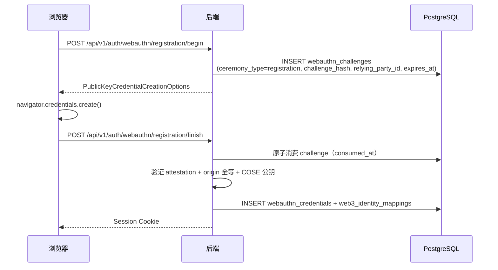
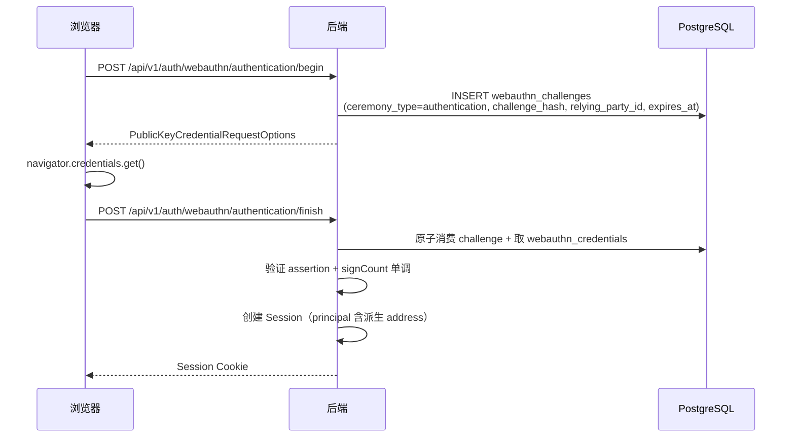

# WebAuthn/Passkey 与浏览器会话安全

> 设计锚点：[DESIGN:auth/webauthn]

> 目标态规范「WebAuthn/Passkey 与浏览器会话安全」；写作约束见 [docs/README.md](../../README.md)。

---

## 注册 Ceremony 完整规格

> 会话绑定实现：传输层从 `SessionContext` 注入 `SessionUserID`/`SessionOrganizationID`；begin/finish 解析身份时强制「会话用户 == 请求体 username」（不一致 403），finish 另要求 `challenge.UserID == 会话用户`。实现 `internal/app/auth/webauthn_register.go` 的 `registrationUserForCommand`，回归 `webauthn_registration_session_test.go`。

### 时序

```
浏览器 → POST /api/v1/auth/webauthn/registration/begin（已认证会话）
服务端 → 生成 challenge（32B 随机）→ 持久化 + user.id/org.id 绑定
服务端 → PublicKeyCredentialCreationOptions
浏览器 → navigator.credentials.create()
浏览器 → POST /api/v1/auth/webauthn/registration/finish（attestationObject/clientDataJSON 原文）
服务端 → 14 项校验通过后落库
```

### finish 校验清单（14 项）

| # | 校验项 | 失败语义 |
|---|--------|---------|
| 1 | clientDataJSON.type == `webauthn.create` | 400 invalidRequest |
| 2 | challenge 哈希比对匹配且一次性原子消费 | 400 challengeInvalid |
| 3 | origin ∈ 该应用注册 origin 白名单，全等比对 | 403 originNotAllowed |
| 4 | rpIdHash == SHA-256(rp.id) | 403 rpIdMismatch |
| 5 | authData 长度 ≥37 且可解析 | 400 malformedAuthData |
| 6 | attStmt 按 fmt 解析：`none` 允许；其余格式记录日志（不阻断） | 400 attestationInvalid（仅解析失败） |
| 7 | credentialId 全局唯一（含跨租户） | 409 credentialExcluded |
| 8 | COSE 公钥仅接受 EC2 / P-256 / ES256，其余算法拒绝 | 400 algUnsupported |
| 9 | UV 按租户策略比对 flags.UV | 403 uvRequired |
| 10 | attestation conveyance 按策略容忍 | 记录+继续 |
| 11 | AAGUID 提取并写入 aaguid 列；白名单分组校验 | 403 aaguidDenied |
| 12 | BE/BS 解析落库 | 记录 |
| 13 | transports 透传落库 | 记录 |
| 14 | user handle 与已认证会话用户一致性 | 403 |

## 认证 Ceremony 完整规格

### 校验清单

| # | 项 | 实现锚点 |
|---|-----|---------|
| 1 | type=`webauthn.get` | `internal/platform/webauthn/verify.go` |
| 2 | challenge 比对（消费式 Get，一次性） | `internal/app/auth/webauthn_authenticate.go` 的 `ConsumeChallenge` |
| 3 | rpIdHash | `verify.go` |
| 4 | UP 标志 | `verify.go` |
| 5 | signCount 回退检测（双零豁免） | `verify.go` 的 `ErrSignCountRegression` |
| 6 | ES256 签名 | `verify.go` |
| 7 | origin 全等比对 | `verify.go` 的 `MatchOrigin` |
| 8 | UV 策略开关（部署级） | `internal/app/auth/service.go` 的 `WebAuthnRequireUV` |
| 9 | BE/BS 解析 | 缺口登记：`contracts/registries/security-readiness.yaml` S1 |
| 10 | allowCredentials 严格过滤 | `webauthn_authenticate.go`（挑战会话用户绑定 + 凭证属主校验） |
| 11 | 认证 finish 成功后签发**会话** | `webauthn_authenticate.go`（同事务签发） |

### 认证前置与反枚举

- begin/finish 均要求 `organizationSlug`；组织 slug 解析使用 `tenantctx.System` 仅覆盖「slug → 组织」这一步，随后立即收窄到该组织的租户作用域。
- 组织 `disable_signin`、用户被禁用/封禁、应用 `disableSignin` 一律 **403**。
- `allowCredentials` 只包含 `active` 凭证；`deactivated/revoked` 凭证不进入浏览器选择列表，避免“弹窗成功但 finish 被拒”。
- 用户不存在与“无 active 凭证”折叠为同一个 **422 credential_not_found**，防止匿名 begin 成为用户名枚举探针。
- begin 响应返回 `userVerification`（`required` / `preferred`），与 finish 的 UV 策略同源；不得只在 finish 侧校验。
- 认证器可不上报计数器（received=0，规范允许）：收到 0 时不写回，避免仓储单调性谓词把 0/0 误判为回退；真正的回退（received>0 且 < stored）仍在写入前拒绝。

### 凭证状态闭环

`webauthn_credentials` 状态机：`active ↔ deactivated`，终态 → `revoked`（管理员吊销/泄露处置，无恢复边）。删除 = 置 `revoked` + 撤销该用户全部会话（级联触发点已联动）。

## Challenge 生命周期

| 维度 | 值 |
|------|-----|
| 存储 | `webauthn_challenges` 表：只存 SHA-256（明文不落库） |
| TTL | 5min |
| 一次性 | 条件更新 `SET consumed_at=now() WHERE id=$1 AND consumed_at IS NULL` |
| 多副本 | 天然共享（无进程内状态），进程重启不丢 |
| 清理 | 周期清理作业在过期会话同节拍调用（保留期 24h） |

## RP ID 与 origin 精确校验

### RP ID 约束

- RP ID 必须为来源的**可注册后缀域**（绝不可为组织 slug）
- 从 WebAuthn 来源集合（`CORS_ALLOWED_ORIGINS` ∪ `ISSUER_URL`）推导：取各来源主机的公共标签后缀
- 空集合、跨可注册域、除 `localhost` 外的单标签主机在 begin 即 fail-closed

### origin 白名单

- 复用 CORS allowlist 并按 `ISSUER_URL` 的来源兜底
- 对 `clientData.origin` 做全等比对（scheme/host 小写折叠、默认端口省略、忽略路径）
- 通配符条目不参与匹配

## Passkey 语义与 Conditional UI

### BE/BS 位（authData.flags bit3/bit4）

| BE | BS | 语义 | 服务端处置 |
|----|----|------|-----------|
| 0 | 0 | 设备绑定凭证（security key） | 正常 |
| 1 | 0 | 可同步、尚未同步 | 正常 |
| 1 | 1 | **同步式 passkey**（多设备共享） | signCount 双零/停走不判克隆，风险以风险引擎补偿 |

### ResidentKey/discoverable credential

`authenticatorSelection.residentKey` ∈ `required/preferred/discouraged`（缺省 `preferred`）；`required` 时 username-less 登录可行。

### Conditional UI

前端 `navigator.credentials.get({mediation:'conditional'})` + `<input autocomplete="username webauthn">`；服务端 begin 匿名可达 + 限流。

## Cookie 属性与 SameSite 矩阵

### Cookie 属性

| Cookie | 属性 | 值 |
|--------|------|-----|
| `session` | HttpOnly/Secure/SameSite/Path/Max-Age | ✓/跟随 COOKIE_SECURE/**Strict**（安全模式；开发模式 Lax）//30d；安全模式下名为 `__Host-session`，HTTP 开发模式下 `session_id` |
| csrf | HttpOnly=false（JS 可读）/Secure/SameSite/Path | 跟随 COOKIE_SECURE/Lax/`/`；安全模式下名为 `__Host-csrf`，HTTP 开发模式下 `csrf_token`；值为服务端生成的 **256-bit crypto/rand 随机双提交令牌（hex）**，**不使用会话 HMAC**（`internal/platform/middleware/csrf.go`，与 login.md §会话 Cookie 属性同源） |

### SameSite 矩阵

会话 Cookie 安全模式为 **Strict**（`__Host-` 前缀强制；开发模式 Lax，见 `internal/transport/http/api/v1/auth/cookie.go`）。Strict 下**任何跨站请求（含顶级 GET）都不携带会话**，矩阵按该基线推导：

| 场景 | 请求形态 | 安全模式 Strict 下会话随行？ | 处置 |
|------|---------|--------------------------|------|
| OIDC 授权码回调 | 跨站顶级 GET redirect | **否**（Strict 屏蔽一切跨站携带） | IdP 发起跳转经本域 302 中转，或回调端点凭 state/授权码重建会话 |
| SAML ACS / CAS serviceValidate | 跨站顶级 POST / GET | **否** | SAML SP ACS 走保护链外公开路由，凭签名 RelayState 重建会话；CAS 凭票据校验建立会话 |
| Front-Channel Logout iframe | 跨站 iframe 内 | 否 | logout 端点凭 URL 携带的 iss+sid 签名参数撤销 |
| SPA 同站 XHR | 同站 | 是 | 维持 |

开发模式 Lax 仅放宽跨站顶级 GET，不构成安全模式的设计前提；与《frontend/security.md》SameSite 口径统一。

## CSRF 豁免边界

CSRF 双提交的放行路径只有四类（事实源：`internal/platform/middleware/csrf.go`、`internal/transport/http/api/v1/auth/auth_paths.go`、`internal/bootstrap/chi.go`；复现：`grep -n 'clientAuthenticatedProtocolPaths' internal/transport/http/api/v1/auth/auth_paths.go`）：

1. **客户端认证协议端点精确清单**（POST-only）：以 `auth_paths.go` 的 `clientAuthenticatedProtocolPaths` 为唯一定义（令牌交换/内省/撤销、设备流、DCR 等调用方以 client secret/签名断言认证自身的端点），契约中不存在浏览器会话。清单精确到方法 + 路径，新增条目必须是显式安全决策，不得用前缀推断；本文不复制清单（复现：`sed -n '/clientAuthenticatedProtocolPaths = map/,/^}/p' internal/transport/http/api/v1/auth/auth_paths.go`）。
2. **已验证 Bearer 会话**：`Authorization: Bearer` / `X-Access-Token` 中的 JWT 经 `SessionContextMiddleware` 验签建立会话后豁免（SCIM 面即走此路径）；原始请求头本身、无效令牌与 Cookie 会话仍必须双提交。
3. **保护链外公开路由**：SAML SP ACS 经 `RegisterPublicRoutes` 挂在 session/CSRF 中间件之外（跨站表单 POST 在无会话时到达），不是「豁免登记」。
4. **安全方法天然放行**：GET/HEAD/OPTIONS 只补发 cookie 不校验（CAS serviceValidate/proxyValidate 为 GET，由此放行）。

**WebAuthn authentication/finish 不在 CSRF 豁免清单**：匿名 POST 仍要求双提交令牌；其匿名可达性来自 PEP 公开白名单（`isAuthLoginFlowPublic`），与 CSRF 是两道独立门。registration/* 需要已认证会话，同样不豁免。

## 路由与鉴权矩阵

| 端点 | 鉴权 | 限流 |
|------|------|------|
| POST /api/v1/auth/webauthn/registration/begin、/api/v1/auth/webauthn/registration/finish | **已认证会话**（Bearer 或 session），finish 校验会话用户 == user handle | AuthRateLimit |
| GET /api/v1/auth/webauthn/credentials；DELETE /api/v1/auth/webauthn/credentials/{id} | **已认证会话**；列表/停用只作用于会话本人（对象归属在应用层校验） | AuthRateLimit |
| POST /api/v1/auth/webauthn/authentication/begin、/api/v1/auth/webauthn/authentication/finish（含 Conditional UI） | 匿名可达（username 可空场景；PEP 公开白名单，CSRF 双提交仍强制） | AuthRateLimit + 匿名 challenge 配额 |
| GET/DELETE /users/{id}/webauthn-credentials* | Admin | 管理面限流 |

路径以 `internal/transport/http/api/v1/webauthn/chi.go` 与 `routes.go` 为准（复现：`grep -n 'webauthn' internal/transport/http/api/v1/webauthn/routes.go`）。

## 双超时默认值

| 参数 | 默认值 | 事实源 |
|------|--------|--------|
| idle_timeout | 30min（组织策略可覆盖） | `internal/app/auth/session_policy.go` 的 `defaultIdleTimeoutMinutes` |
| 会话绝对寿命 | `expires_at = 创建时间 + sessionTTL`（**30d**） | `internal/app/auth/login.go` 的 `sessionTTL` |
| Cookie Max-Age | 30d（收敛为会话绝对寿命） | `internal/transport/http/api/v1/auth/cookie.go` 的 `sessionCookieTTL` |

独立的 `absolute_timeout` 参数（如 12h/控制台 8h 分级）为**规划态**产品决策，运行期无该配置锚点（复现：`grep -rn 'absolute_timeout' internal/ contracts/registries/`）；已登记开放项注册表 OPEN-API-80。

## 管理员强制下线 API

| 端点 | 语义 | 权限 |
|------|------|------|
| `GET /api/v1/users/{id}/sessions` | 当前活跃会话清单（脱敏） | `users:read` + 本人或 Admin |
| `DELETE /api/v1/users/{id}/sessions/{sessionId}` | 撤销单会话 | `users:write` + Admin（本人可自撤销） |
| `DELETE /api/v1/users/{id}/sessions` | 撤销全部会话 | `users:write` + Admin |

- 撤销传播：opaque 会话撤销实时；联动撤销 refresh token family；内省缓存失效
- 闭环触发点：WebAuthn 凭证删除 → 同一事务内撤销该用户全部会话
- 审计：写 `records`（撤销者/原因/来源 IP）


## 记住设备与恢复令牌（remember-me）

| 项 | 规范 |
|----|------|
| 页面入口 | 登录页「记住此设备」勾选项；勾选后由登录端点在应答中下发信任设备 Cookie，浏览器只承担传递职责 |
| 恢复令牌 | 仅存哈希 + family；一次性消费，轮换即作废旧令牌 |
| 交换端点 | `POST /api/v1/auth/remember-me/exchange` 必须**匿名可达**（使用场景是会话过期后恢复），不得要求既有会话，也不得命中「需会话但跳过 Casbin」名单 |
| 撤销 | 用户登出、改密、凭证删除、管理员强制下线均撤销该设备族令牌并写审计 |
| 审计 | `auth.remember_me.issued` / `auth.remember_me.rotated` / `auth.remember_me.revoked`，记录设备指纹摘要与结果 |

## 注册与失败审计

事件以 `contracts/registries/events.yaml` 为唯一事实源；发射点以代码为准（复现：`grep -n 'embedAuditOutboxPlain' internal/app/auth/webauthn_register.go`）：

| 场景 | 事件 | 说明 |
|------|------|------|
| 自助注册 finish 成功（写入 EVM 映射时） | `web3.identity.created` | 记录派生地址映射（`internal/app/auth/webauthn_register.go`） |
| 自助注册 finish 的会话轮换 | `session.revoked` + `session.created` | 旧会话撤销与新会话签发同事务留痕 |
| 管理员代注册 | `users.webauthn.credential.registered` | `internal/app/users/webauthn_admin.go` |
| 认证期签名计数异常 | `webauthn.credential.clone_suspected` | 触发凭证吊销与强制下线，按 critical 安全事件告警（`webauthn_authenticate.go`、`step_up.go`） |

`webauthn.credential.added` / `webauthn.credential.registration_failed` 为注册表已登记的**目标态**注册审计事件；运行期发射点以复现命令为准（`grep -rn 'webauthn.credential.added\|webauthn.credential.registration_failed' internal/`），登记与发射的对齐属契约登记事项。

失败与拒绝同样写 `records`；审计 actor 取会话主体，不取请求体自报身份。

## 协议域声明

完整 OAuth2/OIDC 协议扩展见《design/protocol/oauth2.md》。WebAuthn 需求锚点：SRS §5.1.6（AUTH-041/042/043）。

---


## 附录：Passkey 登录与 EVM 地址派生

Passkey（WebAuthn secp256r1）是浏览器无密码登录通道；注册成功后服务端从公钥确定性派生 EVM 地址并写入 `web3_identity_mappings`，用于在 Web3 语境标识该 Passkey 用户。私钥永不离开认证器，服务端只存公钥。

### A.1 实现锚点

- `internal/app/auth/webauthn_register.go`、`webauthn_authenticate.go`：两段 ceremony 的事务编排与会话签发
- `internal/platform/webauthn/verify.go`：密码学验证、origin 全等、signCount 回退检测
- `internal/app/auth/webauthn.go`：RP ID 与 allowedOrigins 配置
- `internal/transport/http/api/v1/webauthn/`：四个协议端点

### A.2 地址映射数学

```
compressed_pubkey = 0x02/03 || x (32 bytes)   // 33 bytes
seed    = keccak256(compressed_pubkey || "guliangiam-web3-v1")
address = "0x" || hex(seed[12:])              // 20 bytes, EIP-55 checksum
```

该地址是 Passkey 公钥的确定性哈希映射（`derivation_method=keccak256-passkey`），不对应任何已知私钥，不能用于链上花费；链上智能账户授权属于独立扩展，不在本流程内。

### A.3 Ceremony 流程

注册（需已认证会话）：



认证：



### A.4 数据模型

| 实体 | 表 | 语义 |
|---|---|---|
| Passkey 凭证 | `guliangiam.webauthn_credentials` | `credential_id` / `public_key` / `sign_count` / `aaguid` / `status`（`active` / `revoked` / `deactivated`） |
| Ceremony 挑战 | `guliangiam.webauthn_challenges` | 只存 `challenge_hash`（SHA-256）；`ceremony_type` 区分注册与认证且 finish 不得互换；`consumed_at` 原子一次性消费；`expires_at` 为 TTL；`relying_party_id` 在 begin 固化 |
| 地址映射 | `guliangiam.web3_identity_mappings` | `credential_id` → `wallet_address`；`derivation_method` / `derivation_seed` / `chain_ids` |

列、索引、约束与 RLS 以 `contracts/schema/40_session.yaml`、`contracts/schema/20_identity.yaml` 为准（复现：`python3 scripts/gen_schema.py --check`），不在正文复制 DDL。

### A.5 API 契约

四个端点：`/api/v1/auth/webauthn/{registration,authentication}/{begin,finish}`。注册权限 `webauthn:write` 且需要已认证会话；认证权限 `webauthn.auth`，begin/finish 在匿名公开清单内，finish 成功后才签发会话。路径、DTO 与错误码以生成物 `openapi/openapi.yaml`（复现：`python3 scripts/gen_openapi.py --check`）与 `internal/transport/http/api/v1/webauthn/routes.go` 为准。

### A.6 前端契约

| 组件/模块 | 职责 | 约束 |
|---|---|---|
| `web/src/pages/auth/Web3LoginPanel.tsx` | 登录面板与 Passkey ceremony 编排 | 唯一 Passkey 登录入口；不得新增第二个 WebAuthn 组件 |
| `web/src/shared/lib/webauthn-b64.ts` | 二进制 ↔ base64url 编解码 | 纯函数，无网络/状态 |
| `web/src/shared/api/iam/auth-webauthn.ts` | 四端点 API 契约 | 经 `shared/api/http.ts` 统一入口 |

Passkey 使用浏览器原生 WebAuthn API，不引入钱包 SDK。组件名 `Web3LoginPanel` 为历史命名，语义是 Passkey 登录。

### A.7 安全校验清单

| # | 校验项 | 实现位置 | 标准 |
|---|--------|---------|------|
| 1 | Origin 全等比对（防钓鱼） | `internal/platform/webauthn/verify.go` | FIDO2 §6.3.3 |
| 2 | Challenge 一次性消费（防重放） | `webauthn_challenges.consumed_at` 原子 UPDATE | 等保 2.0 访问控制 |
| 3 | Challenge TTL | `webauthn_challenges.expires_at` | 等保 2.0 资源控制 |
| 4 | RP ID 严格配置 + fail-closed | `internal/app/auth/webauthn.go` | FIDO2 §5.4.1 |
| 5 | SignCount 回退检测（防克隆） | `verify.go` 的 `ErrSignCountRegression` | FIDO2 §6.3.6 |
| 6 | 密码学算法 secp256r1 | ES256（COSE alg -7） | NIST SP 800-56A |
| 7 | HTTPS 传输 | 全局 HSTS | 等保 2.0 通信保密性 |
| 8 | 地址推导确定性 | `keccak256(pubkey \|\| seed)` | 等保 2.0 数据完整性 |
| 9 | 凭证吊销机制 | `webauthn_credentials.status` + 审计 | 等保 2.0 访问控制 |
| 10 | 租户绑定审计 | `webauthn_challenges.organization_id` + `records` | 等保 2.0 安全审计 |
