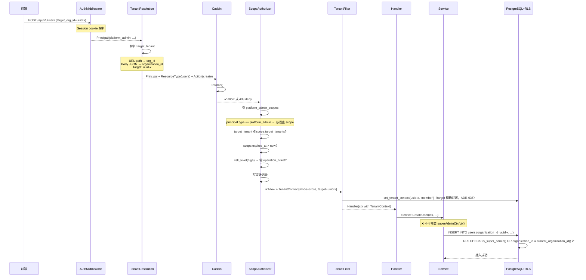

# 权限域详细设计

> 设计锚点：[DESIGN:iam/permissions]

> 本文件是权限域（权限标识、Casbin 模型、跨租户授权、RLS 隔离、平台管理员模型）的目标态设计规范，遵循 [docs/README.md](../../README.md) 写作红线。

---

## 定位

权限是 Casbin 策略引擎的最小授权单元，格式为 `resource:action`（如 `users:read`、`users:write`、`users:delete`）。权限标识通过角色聚合后授予用户，Casbin Enforcer 在每次请求 PEP 判定时求值。

## 权限标识格式

```
{resource}:{action}
```

| resource | 典型 action |
|----------|------------|
| `users` | `read` / `create` / `write` / `delete` / `import` / `impersonate` |
| `organizations` | `read` / `write` / `security-policy:read` / `security-policy:write` |
| `applications` | `read` / `create` / `write` / `delete` / `rotate-secret` |
| `roles` | `read` / `create` / `write` / `delete` |
| `sessions` | `read` / `force-logout` |
| `audit` | `read` |
| `tokens` | `read` / `revoke` / `introspect` |
| `groups` | `read` / `create` / `write` / `delete` |
| `certs` | `read` / `create` / `rotate` / `revoke` |

## Casbin 模型选型

- 模型类型：`RBAC with domains`（ADR-003）
- 适配器：`internal/infra/casbin/`（Go-Casbin + PostgreSQL 持久化 policy）
- matcher：`g(r.sub, p.sub, r.dom) && r.obj == p.obj && r.act == p.act`

## 权限与前端守卫

前端权限守卫组件为 `PermissionGuard`（事实源：`web/src/shared/ui/PermissionGuard.tsx`），Props 为 `{ action?, resource?, fallback?, children }`：基于 `usePermissions` 的 `hasAction` / `hasResource` 判定，加载中渲染 Skeleton，未命中时渲染 `fallback`（未提供则渲染 403 Result）。路由级与业务组件级守卫复用同一组件，Props 与判定逻辑以组件源码为准，文档不复制实现。

后端 PEP 判定与前端守卫**独立双保险**——前端守卫是 UX 优化（不让无权限用户看到页面），后端 Enforcer 是安全边界（必须放行才返回 200）。

## API 事实源

权限域 API 端点清单以 `internal/transport/http/api/v1/permissions/routes.go` 为准。权限标识注册表以 `contracts/registries/` 为准。

---


## 1 授权反模式与设计拒绝项

本章列出本设计**明确拒绝**的授权实现方式，以及对应的目标设计。任何绕开下列约束的实现都按缺陷处理，回收路径见 §8。

| 设计目标 | 口径 |
| --- | --- |
| 单一判定入口 | 跨租户能力只经 ScopeAuthorizer 判定，禁止业务层自行绕过租户隔离 |
| 最小授权 | 授权带作用域（哪些租户）、时效（何时失效）、审批（高风险需操作票） |
| 可追溯 | 每次跨租户判定写入统一审计并纳入哈希链 |
| fail-close | 判定链任一环节异常（策略不可用、租户不确定、scope 缺失）一律拒绝 |

### 1.1 拒绝「万能放行」的租户绕行上下文

在 Service 层把租户上下文切换成超级管理员以绕过 RLS 的做法被禁止：

| 反模式 | 为什么拒绝 |
| --- | --- |
| 无边界 | 任何 Service 只要切换上下文即可绕过租户隔离 |
| 无审计 | 绕行是隐式的，不记录「谁、为什么、操作了什么」 |
| 无作用域 | 绕行后可操作任意组织的数据，无法限定到 A/B 组织 |
| 无时效 | 绕行永久有效，不会自动过期 |
| 维护成本 | 调用点散落在各业务包，重构需逐文件修改 |

**目标设计**：跨租户能力只由 ScopeAuthorizer（Layer 2）授予，带作用域、时效、审批与统一审计（§3.3、§7）。

### 1.2 拒绝「业务角色名即放行」的跨租户策略

```sql
-- 拒绝：业务请求以角色名直接越过目标租户过滤
USING (organization_id = current_setting('app.current_organization_id')::uuid
       OR current_setting('app.current_role') = 'super_admin')
```

业务请求不得因为角色名为 `super_admin` 就获得全库可见性：这会让「已获 ScopeAuthorizer 批准的 target=X」退化为全库旁路。现行强制层是 role-based GUC（`app.current_role` + `app.current_organization_id`，见 §6.1/§6.2）；`super_admin` 仅保留给两类必须伴随审计的框架路径：`system` 内部任务，以及平台管理员无显式 target 时的全租户总览。显式跨租户的收紧决策见 [ADR-036](../../adr/ADR-036-scope-aware-rls-hybrid.md)，实施跟踪见 `OPEN-API-42`。

### 1.3 拒绝用单一布尔字段承载多层身份

```yaml
# contracts/schema/20_identity.yaml
is_admin BOOLEAN NOT NULL DEFAULT false
```

`is_admin` 不得同时表达「组织管理员」与「平台管理员」两种语义。**设计规则**：授权主体身份只来自 `platform_admins`（平台级）与 `user_role_bindings`（组织级）；`is_admin` 仅作展示，不参与任何授权判定。

### 1.4 拒绝由客户端扩展租户上下文

租户上下文以 session 所属组织为默认，显式跨租户必须由 ScopeAuthorizer 判定并落到**单一目标租户**；请求 body/query/header 中的 `organizationId` 不是可信输入，只能经 `auth.TrustedOrganizationID` 解析（§6.3、§6.4）。同一请求同时访问多个租户（scope 数组 / 多 target 授权）不作为当前设计承诺，登记为 `OPEN-API-42`；不得用客户端传入的 `organization_id` 自行扩展租户上下文。

***

## 2. 权限模型定义

### 2.1 四种主体类型

```sql
-- 主体类型枚举（定义在 application constant）
type PrincipalType string

const (
    PrincipalTypePlatformAdmin  PrincipalType = "platform_admin"   -- 平台管理员（独立表）
    PrincipalTypeUser           PrincipalType = "user"            -- 组织级用户
    PrincipalTypeServiceAccount PrincipalType = "service_account" -- 服务账号（M2M）
    PrincipalTypeSystem         PrincipalType = "system"          -- 系统任务（定时、清理等）
)
```

### 2.2 角色 × 主体类型矩阵

| 主体类型                 | 角色                     | 权限范围           | 存储位置                                              |
| -------------------- | ---------------------- | -------------- | ------------------------------------------------- |
| **platform\_admin**  | Platform Admin + Scope | 按 scope 限定的多组织 | `platform_admins` 表 + `platform_admin_scopes` 关联表 |
| **user**             | Org Admin              | 本组织内全部管理权限     | `users.is_admin` + `users.organization_id`        |
| **user**             | Member                 | 本组织内部分操作       | Casbin Policy                                     |
| **service\_account** | Service Account        | 按绑定角色          | `service_accounts` 表 + Casbin Policy              |
| **system**           | System Task            | 系统级后台操作        | 直接代码中标记                                           |

### 2.3 权限点粒度

三层粒度：**资源类型 × 动作 × 风险级别**

```
ResourceType × Action × RiskLevel → ScopeAuthorizer 判定

ResourceType（资源类型）：
  organizations, users, groups, roles, permissions,
  applications, providers, resources, entries,
  tokens, invitations, certificates, radius_configs,
  rules, face_id_providers, adapters, agents,
  transactions, orders, products, subscriptions, payments,
  sessions, records, webhooks, mcpservers,
  certificates, resources, entries, groups ...

Action（动作）：
  read, list, search,
  create, update, delete, revoke,
  impersonate, audit, export, import,
  approve, reject ...

RiskLevel（风险级别）：
  low       ← read/list/search（只读）
  medium    ← create/update 单条写入
  high      ← delete/revoke/impersonate 单条敏感
  critical  ← batch delete / export / import / 跨组织批量
```

### 2.4 租户边界映射规则

```
普通用户访问自己组织：
  TenantScope.mode = strict（受保护请求）或 optional（公开发现端点）
  organization_id = session.organization_id
  RLS: app.current_role = 'member'，app.current_organization_id = session org
      策略 is_super_admin() OR organization_id = current_organization_id()

平台管理员显式跨租户访问（ADR-036 决策）：
  ScopeAuthorizer 校验 target_tenant ∈ platform_admin_scopes.target_tenants
  TenantScope.mode = cross
  organization_id = target_tenant（必须是单一、非空）
  RLS: app.current_role = 'member'，app.current_organization_id = target_tenant
      策略只返回 target 租户行（实现：`TenantFilterCross` + `prepareRLSConn` 映射 member/target，测试 `tenant_resolution_test.go::TestScopeAuthorizer_CrossScopeTargetsSingleTenant`；审计旁路仍跟踪 OPEN-API-42）

旁路审计：无 target all-scope 平台管理员的 RLS 全库旁路写哈希链审计（`AuditTenantBypass`：actor/来源租户/资源/动作/风险/决策/原因），实现 `AllowIfScopedScopeAuthorizer.AuditTenantBypass`，回归 `TestScopeAuthorizer_AllScopeNoTargetAuditsBypass`；worker/system 作用域在组合根启动时集中审计一次（`worker.system_scope`），任务级用结构化日志追溯。

平台管理员无显式 target：
  TenantScope.mode = super_admin
  保留全租户总览语义（RLS 全库旁路），该路径必须伴随审计（ADR-036）

系统任务：
  TenantScope.mode = system
  RLS: app.current_role = 'super_admin'，app.current_organization_id = ''
  仅由 Worker/Cron/迁移等框架入口注入，不得由 HTTP 请求触发；旁路必须写审计

多租户集合 / scope 数组：
  暂缓，不进入当前 schema 与 GUC 契约；出口条件见 OPEN-API-42
```

***

## 3. 双层授权架构

### 3.1 架构总览

```
┌─────────────────────────────────────────────────────────────────────┐
│                         请求生命周期                                │
├─────────────────────────────────────────────────────────────────────┤
│                                                                     │
│  [HTTP Request]                                                     │
│      │                                                              │
│      ▼                                                              │
│  ① AuthMiddleware（认证）                                           │
│      验证 session cookie / JWT                                      │
│      解析 Principal (user_id, type, organization_id)                 │
│      │                                                              │
│      ▼                                                              │
│  ② TenantResolutionMiddleware（解析目标租户）                        │
│      从请求中解析 target_tenant：                                    │
│        - URL path parameter                                         │
│        - query 参数                                                 │
│        - request body                                               │
│        - session 默认值（普通用户）                                  │
│      │                                                              │
│      ▼                                                              │
│  ③ Casbin Middleware（Layer 1：资源授权）                            │
│      Enforce(principal, resource_type, action) → allow/deny          │
│      判定"这个主体能不能操作这类资源"                                │
│      │                                                              │
│      ▼                                                              │
│  ④ ScopeAuthorizer Middleware（Layer 2：作用域授权）★核心★          │
│      Authorize(principal, target_tenant, resource, action, risk)    │
│      ├── principal.type == 'platform_admin' ?                        │
│      │   ├── 查 platform_admin_scopes                              │
│      │   ├── target_tenant ∈ scope.target_tenants ?                     │
│      │   ├── scope.expires_at > now ?                               │
│      │   ├── risk_level → 需要 operation_ticket ?                   │
│      │   └── 写入审计                                               │
│      ├── principal.type == 'user' ?                                 │
│      │   └── 简单 owner 匹配（旧模式，目标态不采用）                │
│      └── other → 走默认策略                                         │
│      │                                                              │
│      ▼                                                              │
│  ⑤ TenantFilterMiddleware（注入 RLS GUC）                            │
│      按 TenantScope.mode 写入标量 GUC（§6.2）：                      │
│        app.current_role = 'member' | 'super_admin'                  │
│        app.current_organization_id = session org / target tenant    │
│      显式跨租户的 target 精确过滤见 ADR-036（实现跟踪 OPEN-API-42）  │
│      │                                                              │
│      ▼                                                              │
│  ⑥ Handler → Service → Repository → RLS 强制执行隔离               │
│                                                                     │
└─────────────────────────────────────────────────────────────────────┘
```

### 3.2 Casbin（Layer 1：资源授权）

Casbin 负责\*\*"是什么主体能不能做什么动作"\*\*，不关心租户边界。

**Policy Model**：

```
[request_definition]
r = sub, obj, act

[policy_definition]
p = sub, obj, act

[role_definition]
g = _, _

[policy_effect]
e = some(where (p.eft == allow))

[matchers]
m = g(r.sub, p.sub) && r.obj == p.obj && r.act == p.act
```

**Policy 示例**：

```
# platform_admin 可以操作所有资源
p, platform_admin, *, *

# org_admin 可以操作本组织资源
g, org_admin, user          # org_admin 继承 user 权限
p, user, users, read
p, user, users, list
p, org_admin, users, create
p, org_admin, users, update
p, org_admin, users, delete
`
策略管理面的租户边界：`casbin_rules` 无 `organization_id` 列，permission 的 `resources[0]` 指向的 enforcer 与其 model 必须先按可信租户校验（`GetByIDForOrganization`）；跨租户引用统一 404 且不触达 Casbin 读写。实现：`internal/app/permissions/service.go`（策略读/写/enforce 入口）与 `validation.go`（Create/Patch 归属校验），回归 `permission_resources_tenant_test.go`、`policy_tenant_test.go`。

PEP 归一化：全局 `APIAuthorizationMiddleware` 以 `resourceFromPath` 推导资源、`casbinActionCandidates` 把 HTTP 方法映射为 CRUD 候选（GET/HEAD→read，POST/PUT/PATCH→write，DELETE→delete，并尝试 verb 别名），显式权限点由 `splitDeclaredPermission` 拆分；因此种子策略的 resource+CRUD 词表可命中普通角色。单条 `RequirePermission` helper 同样归一化（`casbinObjectAndAction`，OPEN-API-72 复核）。
``

### 3.3 ScopeAuthorizer（Layer 2：作用域授权）★核心★

ScopeAuthorizer 负责\*\*"这个主体对这个具体租户的这个具体操作有没有权限"\*\*，填补 Casbin 无法覆盖的租户边界判定。

```go
// ScopeAuthorizer 接口（Go）
type ScopeAuthorizer interface {
    Authorize(ctx context.Context, req AuthorizationRequest) (AuthorizationResult, error)
}

type AuthorizationRequest struct {
    Principal      Principal          // platform_admin / user / service_account / system
    TargetTenant   *uuid.UUID         // 目标租户（nil=本租户或所有）
    ResourceType   ResourceType       // users / organizations / applications / ...
    Action         Action             // read / create / update / delete / impersonate / ...
    RiskLevel      RiskLevel          // low / medium / high / critical
    OperationTicket *uuid.UUID        // 高风险操作票（可选）
    TraceID        string
    SourceIP       net.IP
    UserAgent      string
}

type AuthorizationResult struct {
    Allowed        bool
    Reason         string             // 拒绝原因：scope_not_found / tenant_not_in_scope / scope_expired / ...
    ScopeID        *uuid.UUID
    ScopeExpiresAt *time.Time
    NeedApproval   bool               // 本次操作是否需要审批
    AuditRecord    AuditRecord        // 审计记录（allow 和 deny 都写）
    TenantContext  TenantContext      // 注入 Handler 的租户上下文
}
```

***

## 4. 跨租户触发条件与校验流程

### 4.1 请求生命周期时序图



### 4.2 五种场景的校验流程

#### 场景 1：普通用户访问自己组织

```
Principal: user (org-y)
Target: org-y（session 默认）
Casbin: 校验资源权限（user + users + read ✅）
ScopeAuthorizer: 跳过（principal.type == 'user'，走 Owner 匹配）
RLS: role=member, org=org-y
结果: ✅
```

#### 场景 2：组织 Admin 管理本组织

```
Principal: user (org-y, is_admin=true)
Target: org-y
Casbin: org_admin + users + create ✅
ScopeAuthorizer: 跳过
RLS: role=member, org=org-y
结果: ✅
```

#### 场景 3：平台 Admin 跨租户读

```
Principal: platform_admin (scope: {org-a, org-b, org-c})
Target: org-b（请求显式指定）
Casbin: platform_admin + users + read ✅
ScopeAuthorizer: ✅ org-b ∈ scope.target_tenants + scope未过期 + risk=low(无需ticket)
RLS: role=member, org=org-b（target 精确过滤，ADR-036）
结果: ✅
```

#### 场景 4：平台 Admin 跨租户写（高风险）

```
Principal: platform_admin (scope: {org-a, org-b})
Target: org-b + DELETE操作
Casbin: platform_admin + users + delete ✅
ScopeAuthorizer: ✅ org-b ∈ scope + risk=high → 需operation_ticket
  ├── ticket 已提供 + 审批通过 → ✅
  └── ticket 未提供 → ❌ NeedApproval + 写审计
RLS: role=member, org=org-b（target 精确过滤，ADR-036）
结果: ✅ / ❌
```

#### 场景 5：平台 Admin 超出 Scope

```
Principal: platform_admin (scope: {org-a, org-b})
Target: org-z（请求指定）
Casbin: platform_admin + users + read ✅
ScopeAuthorizer: ❌ org-z ∉ scope.target_tenants → 写审计（deny）
结果: ❌ 403 Forbidden
```

### 4.3 owner 不一致检测

```go
// TenantResolutionMiddleware 防御层
// 同时从 URL path, query, body 三个来源解析 target_tenant
// 如果三者不一致 → 400 Bad Request（攻击尝试）

func (m *TenantResolutionMiddleware) Resolve(ctx context.Context) (*TenantResolutionResult, error) {
    var sources []*uuid.UUID
    sources = append(sources, parseTenantFromURL(ctx))     // URL path param
    sources = append(sources, parseTenantFromQuery(ctx))   // query ?org_id=
    sources = append(sources, parseTenantFromBody(ctx))    // JSON body {organization_id:}

    // 去重 + 全部相等才通过
    unique := deduplicate(sources)
    if len(unique) > 1 {
        // 🔴 攻击场景：URL 指向 org-a，body 指向 org-b
        return nil, ErrTenantMismatch
    }
    return &TenantResolutionResult{TargetTenant: unique[0]}, nil
}
```

***

## 5. 审计与追溯机制

### 5.1 ScopeAuthorizer 统一审计点

```go
// ScopeAuthorizer 每次 Authorize 调用都写审计（allow 和 deny 都写）
func (s *scopeAuthorizer) Authorize(...) (AuthorizationResult, error) {
    // ... 判定逻辑 ...

    // 统一写审计（无论 allow 还是 deny）
    audit := AuditRecord{
        ActorID:       principal.ID,
        ActorType:     principal.Type,
        ActorName:     principal.Name,
        SourceTenant:  principal.OrganizationID,
        TargetTenant:  req.TargetTenant,
        ResourceType:  req.ResourceType,
        ResourceID:    req.ResourceID,
        Action:        req.Action,
        RiskLevel:     req.RiskLevel,
        ScopeID:       result.ScopeID,
        ScopeExpiresAt: result.ScopeExpiresAt,
        OperationTicketID: req.OperationTicket,
        Decision:      result.Allowed ? "allow" : "deny",
        Reason:        result.Reason,
        SourceIP:      req.SourceIP.String(),
        UserAgent:     req.UserAgent,
        TraceID:       req.TraceID,
        CreatedAt:     time.Now().UTC(),
    }

    // 审计哈希链（每个新记录的 prev_hash 指向上一条记录的 hash）
    audit.PrevHash = s.lastAuditHash(ctx)
    audit.Hash = sha256(audit)

    if err := s.auditRepo.Create(ctx, audit); err != nil {
        // 审计写入失败 → 拒绝请求（fail-closed）
        return AuthorizationResult{Allowed: false, Reason: "audit_failed"}, err
    }

    return result, nil
}
```

### 5.2 审计数据模型

```sql
CREATE TABLE guliangiam.authorization_audit_records (
    id                      UUID PRIMARY KEY DEFAULT gen_random_uuid(),
    actor_id                UUID NOT NULL,
    actor_type              TEXT NOT NULL,          -- platform_admin / user / service_account / system
    actor_name              TEXT,
    source_tenant           UUID,                    -- 发起者的租户（org）
    target_tenant           UUID,                    -- 目标租户（跨租户场景才有）
    resource_type           TEXT NOT NULL,
    resource_id             TEXT,
    action                  TEXT NOT NULL,
    risk_level              TEXT NOT NULL DEFAULT 'low',
    scope_id                UUID,                    -- 使用的 scope（platform_admin 才会有）
    scope_expires_at        TIMESTAMPTZ,
    operation_ticket_id     UUID,                    -- 关联的操作票
    decision                TEXT NOT NULL,           -- 'allow' / 'deny'
    reason                  TEXT,                    -- 拒绝原因
    source_ip               INET,
    user_agent              TEXT,
    trace_id                TEXT,
    created_at              TIMESTAMPTZ NOT NULL DEFAULT now(),

    -- 审计哈希链（防篡改）
    prev_hash               TEXT,
    hash                    TEXT NOT NULL,            -- sha256(prev_hash || json(record_without_hash))

    CONSTRAINT chk_decision CHECK (decision IN ('allow', 'deny')),
    CONSTRAINT chk_risk_level CHECK (risk_level IN ('low', 'medium', 'high', 'critical'))
);

CREATE INDEX idx_audit_actor ON guliangiam.authorization_audit_records(actor_id, created_at DESC);
CREATE INDEX idx_audit_tenant ON guliangiam.authorization_audit_records(target_tenant, created_at DESC);
CREATE INDEX idx_audit_decision ON guliangiam.authorization_audit_records(decision, created_at DESC);
CREATE INDEX idx_audit_scope ON guliangiam.authorization_audit_records(scope_id);
```

### 5.3 审计查询 API

审计查询端点以路由声明为唯一事实源，文档不手写清单：

- 审计记录读/写/搜索：`internal/transport/http/api/v1/records/routes.go`（`/api/v1/audit/records`、`/api/v1/audit/records/search` 及 `/api/v1/records/*` 族）。
- 审计链完整性验证：`internal/transport/http/api/v1/risk/routes.go`（`GET /api/v1/risk/audit-integrity`）。
- 跨租户操作汇总按 `cross_tenant_operations` 的 actor / target 维度过滤查询，不设独立汇总端点；复现：`python3 scripts/gen_openapi.py --check`。

***

## 6 数据隔离 RLS 策略

### 6.1 现行 RLS 策略（role-based GUC）

```sql
-- 现行强制层：标量 GUC + 角色旁路（ADR-016）
USING (guliangiam.is_super_admin()
       OR organization_id = guliangiam.current_organization_id())
WITH CHECK (guliangiam.is_super_admin()
       OR organization_id = guliangiam.current_organization_id())
```

普通请求以 `app.current_role='member'` 与 `app.current_organization_id=<session org>` 生效，只返回本租户行；`super_admin` 只由 `system` 内部任务与平台管理员无显式 target 的全租户总览路径注入。显式跨租户获准后按目标租户精确过滤（[ADR-036](../../adr/ADR-036-scope-aware-rls-hybrid.md) 的 C1；`TenantFilterCross` 实现跟踪 `OPEN-API-42`），不以角色名放行。多租户集合 / scope 数组（`app.current_tenant_scope`、`app.tenant_mode`）暂缓，不进入 GUC 契约。

### 6.2 GUC 契约

| GUC / 函数 | 语义 | 取值 |
| --- | --- | --- |
| `app.current_organization_id` | 当前事务的租户上下文 | UUID，或空串（`current_organization_id()` 返回 NULL） |
| `app.current_role` | RLS 业务角色 | `member` / `super_admin` |
| `guliangiam.set_tenant_context(uuid,text)` | 事务内 LOCAL 注入上述两个 GUC | `(p_organization_id, p_role)` |
| `guliangiam.current_organization_id()` | 策略租户谓词 | `uuid` / NULL |
| `guliangiam.is_super_admin()` | 框架旁路谓词 | `boolean` |
| `guliangiam.resolve_org_id(text)` | uuid/slug 解析辅助（声明于 schema；Go 侧由 `uow.setTenantContext` 与 `prepareRLSConn` 在写 GUC 前完成等价解析） | `uuid` |

GUC 名称以 `contracts/schema/00_infra.yaml` 与 `internal/platform/db/rls.go` 为事实源；本表只表达语义，不复写策略清单。策略清单以 `contracts/schema/*.yaml` 的 `rls` / `rls_predicate` 声明为准。

### 6.3 连接级 RLS 钩子策略（三层防护）

RLS 的可靠性取决于**连接级默认值**与**注入时机**，本设计固定为三层：

```text
AfterConnect（fail-closed 默认）
  └── 新物理连接 → 空 role + 空 org → RLS 全部拒绝

PrepareConn（每次 pool.Acquire 统一注入）
  └── 从 ctx 读取 TenantScope（由租户中间件注入）
  └── 映射 role：SuperAdmin/System → super_admin；其他 → member
  └── slug → UUID 解析（role=member 时需要）
  └── set_config(role, false) + set_config(org_id, false)

AfterRelease（GUC 泄漏防御）
  └── 连接归还 pool 前重置 role='', org=''
```

**设计规则**：

1. **默认必须 fail-closed**。若新连接默认放行，则 Worker / Cron 等不经 HTTP 中间件的路径会静默拿到万能钥匙，且事务结束后连接会回到放行状态——这是本节其他规则无法补救的结构性缺陷。
2. **连接级与事务级分工**：`PrepareConn` 用 `SESSION(false)` 建立 Acquire 期作用域；`WithinTransaction` 再用 `LOCAL(true)` 的 `set_tenant_context` 覆盖为事务内上下文，事务结束自动失效。直接使用 pool 的 Worker/迁移路径依赖连接级设置，HTTP 事务路径依赖事务级覆盖。
3. **必须复用同一个物理连接**：`pool.Exec` 与 `pool.QueryRow` 可能取到不同物理连接，因此必须在同一个 `Acquire` 出来的 `*pgxpool.Conn` 上先 `set_config` 再执行语句。
4. **后台任务的放行必须显式**：Worker / Cron / 后台任务统一经系统模式的租户上下文入口注入，不得依赖连接默认值；该入口必须先于「默认 fail-closed」上线（§8.2）。
5. **归还即重置**：连接释放时清空 GUC，避免租户上下文跨请求泄漏。

**请求链路总览**：

```text
[HTTP Request]
  → ① 认证中间件（解析主体类型：platform_admin / user / service_account）
  → ② 租户中间件（注入 TenantScope：普通用户为 session 组织；平台管理员无显式 target 为超级模式；ScopeAuthorizer 放行显式 target 后为单一目标租户的 cross 模式（ADR-036，实现跟踪 OPEN-API-42）；系统任务为 system 模式）
  → ③ Handler → Service → WithinTransaction 内 `set_tenant_context` LOCAL 覆盖 → Repository
  → ④ pool 取得连接 → PrepareConn 注入 GUC（每次 Acquire 一次）
  → ⑤ SQL 执行，RLS 依 GUC 隔离
  → ⑥ AfterRelease 重置 GUC
```

### 6.4 中间件链顺序

```text
认证中间件 → 租户解析 → Casbin（资源授权）→ ScopeAuthorizer（作用域授权）→ ReBAC → 租户过滤
```

顺序约定：

- Casbin 只判定「资源类型 × 动作」，**不含租户维度**；跨租户场景下的租户维度由 ScopeAuthorizer 负责（否则 Casbin 会先 deny，ScopeAuthorizer 没有执行机会）。
***

## 7. 平台管理员数据模型

### 7.1 platform\_admins 独立表

平台管理员注册表 `guliangiam.platform_admins` 以 `user_id` 唯一关联用户，携带 `is_active` 总开关与 `created_by` 创建者；列清单、约束与 RLS 声明以 `contracts/schema/00_platform.yaml` 为唯一事实源（复现：`grep -n "platform_admins" contracts/schema/00_platform.yaml`），文档不复制 DDL。平台管理员的 MFA 等安全要求由组织/平台安全策略承载，不在本表以布尔列表达。

### 7.2 platform\_admin\_scopes 关联表

跨租户作用域由 `scope_type`（`all` / `targeted`）与 `target_tenants`（UUID 数组）共同定义：`all` 时 `target_tenants` 必须为空数组，`targeted` 时必须非空；`expires_at` 自创建起最长一年；审批链由 `approved_by` / `approved_at` 表达，bootstrap 豁免由 `is_bootstrap` 表达（仅种子/运维为内置管理员写入）。列清单与 CHECK 约束以 `contracts/schema/00_platform.yaml` 为唯一事实源（复现：`grep -n "platform_admin_scopes" contracts/schema/00_platform.yaml`）。

作用域声明不改变 RLS 契约：C1 只使用单一 target，同一请求并发访问多租户不作为设计承诺，登记为 `OPEN-API-42`。

### 7.3 cross\_tenant\_operations 操作票

高风险跨租户操作票存于 `guliangiam.cross_tenant_operations`：操作者列为 `actor_id`（FK → users），关联 `scope_id`、`source_tenant` / `target_tenant`、资源/动作/风险级别、审批链（`approved_by` / `approved_at`）、`expires_at` 与 `used_at`；状态闭集 `pending / approved / rejected / used / expired`。列清单、CHECK 与索引以 `contracts/schema/60_audit.yaml` 为唯一事实源（复现：`grep -n "cross_tenant_operations" contracts/schema/60_audit.yaml`；状态机 `contracts/registries/state-machines.yaml`），文档不复制 DDL。

### 7.4 作用域有效性判定口径

平台管理员作用域的有效性口径唯一：**未过期** 且（`is_bootstrap` 为真 **或** `approved_by` 非空）。bootstrap 行由种子/运维写入并豁免审批；其余行必须已审批，未审批即无效。

事实源（文档不复制清单，只给路径与复现命令）：

| 层 | 口径 | 事实源与复现命令 |
| --- | --- | --- |
| 声明层 | `platform_admin_scopes.is_bootstrap` 只允许种子/运维为内置组织种子管理员写入；`approved_by` 允许为 NULL（bootstrap 行）；`approved_at` 仅在 `approved_by` 非空时要求有值 | `contracts/schema/00_platform.yaml`；`grep -n "is_bootstrap\|approved_by" contracts/schema/00_platform.yaml` |
| 判定层 | Gate 7 跨租户覆盖判定与无显式 target 的作用域分类统一按 `expires_at > now() AND (is_bootstrap OR approved_by IS NOT NULL)` 判定，由 `scopeValidity` 单一常量拼接，禁止各自另写 | `internal/infra/postgres/platform_admins/sql.go`、`internal/platform/scopeauthorizer/allow_if_scoped.go`；`go test ./internal/platform/scopeauthorizer/ -run TestAllowIfScoped_ResolveAdminScope` |
| 种子层 | 内置管理员的 `all` 作用域行 `is_bootstrap = true`、`approved_by` / `approved_at` 为 NULL | `db/seeds/V1__guliangiam_seed_init.sql`；`grep -n "platform_admin_scopes" db/seeds/V1__guliangiam_seed_init.sql` |

**设计规则**：

1. `all` 与 `targeted` 的有效性 = 未过期 且（bootstrap 或已审批）；`approved_by` 与 `is_bootstrap` 是有效性条件，判定层必须以 `scopeValidity` 单一常量拼接，不得另写判定。
2. 恢复「`all` 必须已审批」属于跨层变更，必须同时修改声明层、Gate 7 SQL 与种子，并在隔离库重放验证；任一层单独改动都会让 bootstrap 管理员的作用域解析为 `none`，使其在全租户总览路径上失去可见性。

***

## 8. 安全边界验证清单

| 边界            | 验证方法                               | 预期结果                                                      |
| ------------- | ---------------------------------- | --------------------------------------------------------- |
| **scope 缺失**  | platform\_admin 无对应 scope 尝试跨租户    | ScopeAuthorizer → deny + 审计                               |
| **scope 过期**  | scope.expires\_at 已过               | ScopeAuthorizer → deny                                    |
| **超出 scope**  | target\_tenant ∉ scope.target\_tenants | ScopeAuthorizer → deny + 审计                               |
| **ticket 缺失** | critical 风险操作无 operation\_ticket   | ScopeAuthorizer → NeedApproval                            |
| **ticket 过期** | operation\_ticket 超过 2 小时          | ScopeAuthorizer → ticket\_expired                         |
| **RLS 绕过**    | 绕过中间件直接以 `super_admin` 角色查 DB       | AfterConnect 默认 fail-closed；`super_admin` 仅由 `system` 内部任务与平台管理员无显式 target 的全租户总览路径注入，且必须写审计（ADR-036） |
| **owner 不一致** | URL 指定 org-a，body 指定 org-b         | TenantResolutionMiddleware → 400 Bad Request              |
| **审计篡改**      | 尝试修改 authorization\_audit\_records | audit.hash 链断裂 → 验证失败告警                                   |
| **无权限主体**     | 不是 platform\_admin / user 的主体尝试跨租户 | ScopeAuthorizer → deny-all                                |
| **默认 deny**   | AfterConnect 默认无 scope 直接查 DB      | RLS → 空 scope 返回空结果                                       |

## 9. 受保护路由的权限声明与启动自检

| 项 | 规范 |
|---|---|
| 声明源 | `route.Definition.Permission` 是路由权限的唯一声明点；`contracts/registries/permissions.yaml` 是资源/动作注册表 |
| 启动自检 | 启动期遍历全部路由：非公开路由 `Permission` 为空，或资源/动作未登记 → 拒绝启动；管理面路径命中豁免项 → 拒绝启动 |
| 运行期 | 裁决以路由声明为输入，不在 handler 内另写权限判断；声明与注册表不一致由启动自检阻断 |
| 豁免 | 仅 `contracts/registries/surfaces.yaml` 的 `public_whitelist` 命中项可匿名；匹配粒度为「方法 + 路径模板」，禁止前缀匹配代替精确匹配 |
| 失败姿态 | 自检失败 = 进程不启动（fail-close），不得降级为告警后继续运行 |

## 10. 拒绝路径留痕

| 项 | 规范 |
|---|---|
| 范围 | 权限拒绝（403）、跨租户防枚举（404）、依赖不可用（503）、白名单外匿名访问（401）四类均写 `records` |
| 字段 | actor（或显式系统主体）、组织、资源类型/标识、决策（deny / not_found / unavailable）、原因码、来源 IP、request_id / trace_id |
| 事件名 | `authz.deny`、`authz.cross_tenant_denied`、`security.whitelist_miss` |
| 事务 | 与业务同事务写入；只读拒绝路径走同一 records 追加器 |
| 去重 | 同一 `(actor, target, resourceType, reason)` 60s 窗口只落一条明细，重复计数进入计数指标 |
| 限流 | 独立令牌桶 `RATE_LIMIT_AUDIT_DENIAL_RATE`；超限明细丢弃并告警，响应不阻塞 |
| 失败姿态 | 拒绝审计为尽力而为例外：写入失败进入有界异步补偿队列，重试耗尽只告警/计数，不把拒绝响应变为 503；其他写操作审计仍同事务 fail-close |
| 禁止 | 只写结构化日志、不写 records 的「静默拒绝」 |

***
