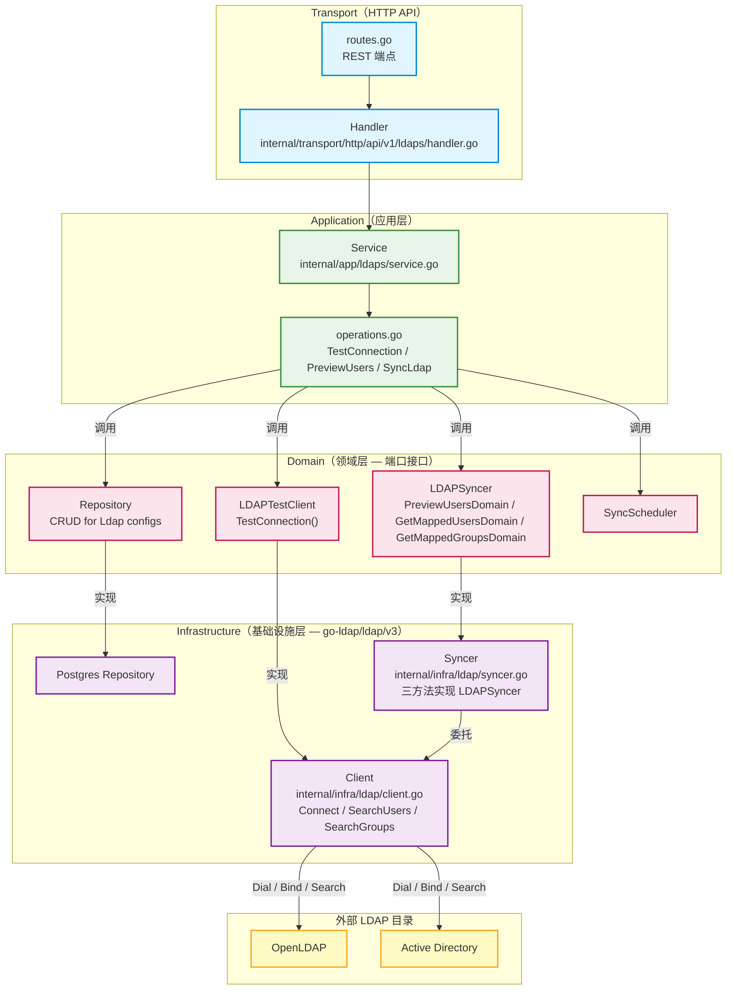
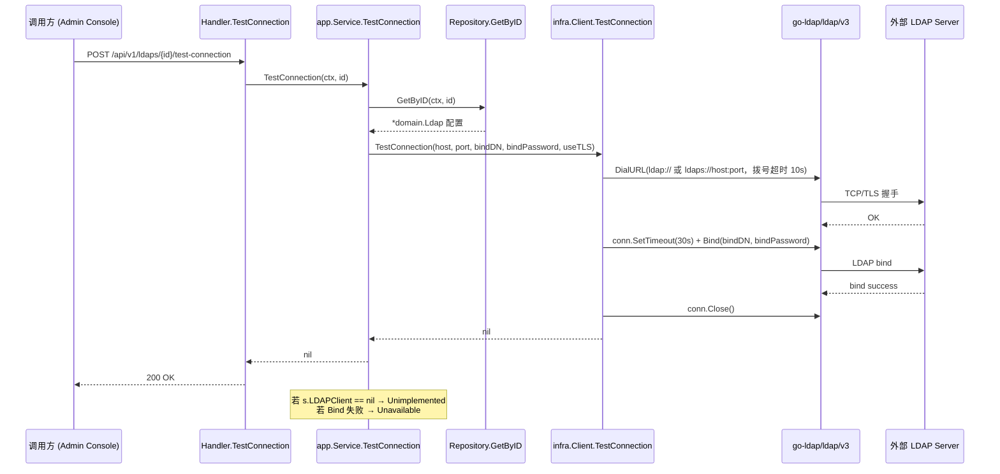
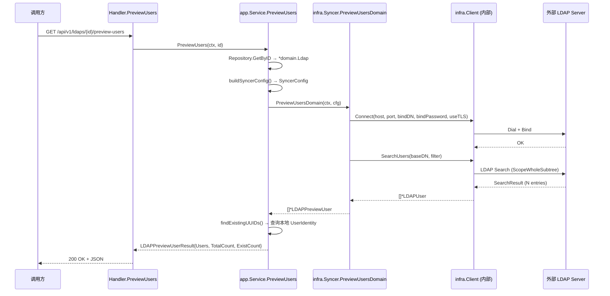
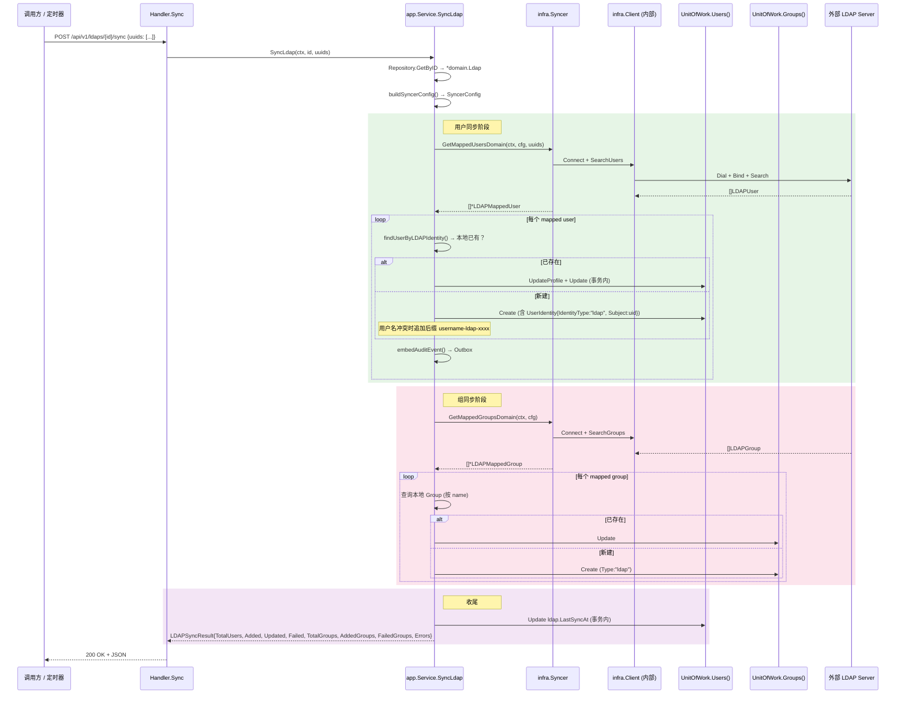

# LDAP 接入与同步规格

> 设计锚点：[DESIGN:protocol/ldap]

> 目标态规范「LDAP 接入与同步规格」；写作约束见 [docs/README.md](../../README.md)。

---

## 1. 定位

LDAP 连接器允许 GuliangIAM **仅作为 LDAP 客户端**对接企业 OpenLDAP 或 Active Directory，实现用户导入、认证代理与组同步。GuliangIAM 不实现嵌入式 LDAP Server。

| 能力 | 说明 |
|------|------|
| 连接测试 | 以 bindDN + bindPassword 建立 LDAP 连接并验证凭据 |
| 用户预览 | 搜索 LDAP 目录，返回用户清单并标记本地已存在的身份 |
| 全量/增量同步 | 将 LDAP 用户/组映射到 GuliangIAM 领域模型（users/groups + UserIdentity） |
| 认证代理 | 委托 LDAP bind 完成用户密码验证（首次登录自动创建本地用户） |

---

## 2. 分层架构

GuliangIAM 的 LDAP 实现严格遵循 Clean Architecture 端口与适配器模式（ADR-005）。领域层定义三个端口接口，基础设施层用 `go-ldap/ldap/v3` 实现。

端点清单以 `openapi/openapi.yaml` 为准（复现：`grep -n '/api/v1/ldaps' openapi/openapi.yaml`）；HTTP 路由声明见 `internal/transport/http/api/v1/ldaps/routes.go`。

### 代码锚点（Code Anchors）

行号会随代码演进漂移，符号名为准（复现：`grep -n '<符号>' <文件>`）。

| 层 | 符号 | 文件:行 | 说明 |
|----|------|---------|------|
| Domain | `LDAPTestClient` | `internal/domain/ldaps/repository.go:29` | 端口接口，`TestConnection(host, port, bindDN, bindPassword, useTLS) error` |
| Domain | `LDAPSyncer` | `internal/domain/ldaps/repository.go:77` | 端口接口，三个同步方法 |
| Domain | `Repository` | `internal/domain/ldaps/repository.go:13` | 配置 CRUD 端口接口 |
| App | `Service` struct | `internal/app/ldaps/service.go:14` | 应用层，持有 `LDAPClient` / `LDAPSyncer` 字段 |
| App | `TestConnection()` | `internal/app/ldaps/operations.go:34` | 连接测试 |
| App | `PreviewUsers()` | `internal/app/ldaps/operations.go:60` | 用户预览 |
| App | `SyncLdap()` | `internal/app/ldaps/operations.go:103` | 同步入口 |
| Infra | `Client` struct | `internal/infra/ldap/client.go:32` | 无状态客户端，底层 `go-ldap/ldap/v3` |
| Infra | `Client.Connect()` | `internal/infra/ldap/client.go:56` | `ldap.DialURL` + `SetTimeout` + Bind，支持 LDAP / LDAPS |
| Infra | `Client.SearchUsers()` | `internal/infra/ldap/client.go:134` | ScopeWholeSubtree，sizeLimit 上限，默认属性集 |
| Infra | `Syncer` struct | `internal/infra/ldap/syncer.go:11` | 持有内部 `*Client`，实现 `LDAPSyncer` |
| Infra | `Syncer.PreviewUsersDomain()` | `internal/infra/ldap/syncer.go:22` | Connect → SearchUsers → 映射 |
| Infra | `Syncer.GetMappedUsersDomain()` | `internal/infra/ldap/syncer.go:54` | 支持 UUID 白名单过滤 |
| Infra | `Syncer.GetMappedGroupsDomain()` | `internal/infra/ldap/syncer.go:101` | Connect → SearchGroups → 映射 |
| Bootstrap | 依赖注入 | `internal/bootstrap/wire_domains.go:171-172` | `ldapService.LDAPClient = infraldap.NewClient()` + `LDAPSyncer = infraldap.NewSyncer()` |
| HTTP | `Handler` | `internal/transport/http/api/v1/ldaps/handler.go:10` | 持有 `appldaps.Service` |
| HTTP | 路由表 | `internal/transport/http/api/v1/ldaps/routes.go` | 端点清单以路由声明为准（复现：`grep -c OperationID internal/transport/http/api/v1/ldaps/routes.go`），全部归属 Management 面 |

### 设计说明

**双 Client 实例**：`Syncer` 内部通过 `NewSyncer()` 创建了自己的 `*Client`，同时 bootstrap 又向 `Service.LDAPClient` 注入了另一个 `*Client`。这是**有意设计**——`Client` 是无状态的轻量对象，每个实例独立 Dial/Bind/Close，互不干扰。如果未来 `Client` 增加连接池或共享连接，再考虑合并。

**超时与资源上限**（`internal/infra/ldap/client.go`，常量定义见文件头部）：

| 参数 | 值 | 机制 |
|------|-----|------|
| 读写操作超时 | 30s（`ldapOperationTimeout`） | `Connect` 成功后 `conn.SetTimeout(ldapOperationTimeout)`，覆盖 Bind/Search 等全部后续读写；不可达但不响应的目录以错误返回而非挂起 |
| 拨号超时 | 10s（`ldapDialTimeout`） | `ldap.DialWithDialer(&net.Dialer{Timeout: ...})`，约束 TCP/TLS 握手（`SetTimeout` 只作用于建连之后） |
| 单次搜索条数上限 | 10000（`ldapSearchSizeLimit`） | Search 请求 `SizeLimit`，防错误 filter 拉爆内存 |
| TLS 最低版本 | TLS 1.2 | LDAPS 连接 `tls.Config{MinVersion: tls.VersionTLS12, ServerName: host}` |

---

## 3. API 表面

所有 LDAP 端点归属**管理面（Management Surface）**，前缀 `/api/v1/ldaps`。

| Method | Pattern | OperationID | 权限 | 代码锚点 |
|--------|---------|-------------|------|----------|
| GET | `/api/v1/ldaps` | ListLdaps | `ldaps:read` | `routes.go:7-14` |
| POST | `/api/v1/ldaps` | CreateLdap | `ldaps:write` | `routes.go:15-22` |
| GET | `/api/v1/ldaps/{id}` | GetLdap | `ldaps:read` | `routes.go:23-30` |
| PATCH | `/api/v1/ldaps/{id}` | PatchLdap | `ldaps:write` | `routes.go:31-38` |
| DELETE | `/api/v1/ldaps/{id}` | DeleteLdap | `ldaps:write` | `routes.go:39-46` |
| POST | `/api/v1/ldaps/{id}/sync` | SyncLdapUsers | `ldaps:write` | `routes.go:47-54` |
| GET | `/api/v1/ldaps/{id}/preview-users` | PreviewLdapUsers | `ldaps:read` | `routes.go:55-62` |
| POST | `/api/v1/ldaps/{id}/test-connection` | TestLdapConnection | `ldaps:write` | `routes.go:63-70` |

---

## 4. 核心流程时序

### 4.1 连接测试（TestConnection）

管理员配置 LDAP 连接器后，先执行连接测试验证凭据与网络可达性。

### 4.2 用户预览（PreviewUsers）

同步前展示 LDAP 目录中存在哪些用户、哪些已在 GuliangIAM 中有对应身份。

### 4.3 同步（SyncLdap）

将 LDAP 用户全量导入或增量更新到本地 `users` / `groups` / `user_identities`。

---

## 5. 连接器配置

| 字段 | 类型 | 说明 |
|------|------|------|
| Name | string | 连接器名称（租户内唯一） |
| Host | string | LDAP 服务器地址（如 `ldap.example.com`） |
| Port | int | 389（LDAP 明文）/ 636（LDAPS）/ 3268（AD Global Catalog 明文）/ 3269（AD GC LDAPS）；TLS 判定 = `EnableSsl || ShouldUseTLS(port)`，`ShouldUseTLS` 仅命中 636/3269（`internal/infra/ldap/client.go`） |
| BindDN | string | 绑定 DN（如 `cn=admin,dc=example,dc=com`） |
| BindPassword | string | 绑定凭据（信封加密存储） |
| BaseDN | string | 搜索根（如 `ou=users,dc=example,dc=com`） |
| Type | string | LDAP 服务器类型：`OpenLDAP` / `ActiveDirectory` / `Generic` |
| Filter | string | 自定义用户过滤器，空时按 Type 取默认值 |
| EnableSsl | bool | 强制 LDAPS（隐式 TLS，最低 TLS 1.2）；389/3268 明文端口上的 STARTTLS 为目标态形态（裁定见 `contracts/registries/open-items.yaml` `OPEN-API-75`） |
| EnableGroups | bool | 是否同步组 |
| SyncInterval | int | 自动同步间隔（分钟），0 表示不自动同步 |
| IsEnabled | bool | 是否启用 |

默认过滤器：

| 服务器类型 | 用户 filter | 组 filter |
|------------|------------|----------|
| OpenLDAP / Generic | `(objectClass=person)` | `(objectClass=groupOfNames)` |
| Active Directory | `(objectClass=user)` | `(objectClass=group)` |

> 代码锚点：`internal/infra/ldap/client.go`（`DefaultUserFilter` / `DefaultGroupFilter`，复现：`grep -n 'func Default' internal/infra/ldap/client.go`）

---

## 6. 字段映射模板

| LDAP 属性 | GuliangIAM 字段 |
|----------|----------------|
| `uid` / `sAMAccountName` | `users.username` |
| `mail` | `user_profiles.email` |
| `cn` / `displayName` | `user_profiles.display_name` |
| `givenName` | `user_profiles.first_name` |
| `sn` | `user_profiles.last_name` |
| `telephoneNumber` | `user_profiles.phone` |
| `title` | `user_profiles.properties["title"]` |
| `departmentNumber` | `user_profiles.properties["department"]` |
| `employeeNumber` | `user_profiles.properties["employeeNumber"]` |
| DN | `user_profiles.properties["ldapDN"]` |
| `userAccountControl` | AD 专属 — bit 2 置位 → `users.status = "suspended"` |

> 同步时若本地已存在相同 `identity_type=ldap` + `subject=uid` 的 UserIdentity，则执行 Update；否则 Create 新 User + UserIdentity（`internal/app/ldaps/operations.go` `upsertLDAPUser`，复现：`grep -n 'upsertLDAPUser' internal/app/ldaps/operations.go`）。

---

## 7. 同步调度

`app/ldaps/service.go` 提供三个调度方法：

| 方法 | 说明 |
|------|------|
| `StartAutoSync(id)` | 为单个启用的连接器注册定时任务 |
| `StopAutoSync(id)` | 移除任务 |
| `ScheduleAllEnabledAutoSyncs(ctx)` | 启动时扫描所有启用连接器，批量注册 |

底层使用 `SyncScheduler` 端口接口，具体实现由 `ldapSyncService`（`app/syncers`）提供。

---

## 8. 冲突解决

| 场景 | 策略 |
|------|------|
| LDAP 有、本地无 | 创建用户（`register_type = "ldap"`, `register_source = "ldap"`） |
| LDAP 有、本地有（`UserIdentity.Subject == uid` 匹配） | 更新 Profile + 状态 |
| LDAP 有、本地有（用户名匹配但 identity 不同） | 新用户用户名追加后缀 `username-ldap-xxxx` |
| LDAP userAccountControl bit 2 置位 | 用户状态 → `suspended` |
| 用户 upsert 失败 | 记录错误，继续下一条，汇总返回 |

---

## 9. SSRF 出口管控

覆盖 LDAP 出站连接：禁内网 IP 段（RFC 1918 + 127.0.0.0/8 + ::1 + 169.254.0.0/16）、禁跟随重定向（限 1 跳且对目标重新校验）、DNS rebinding 防护（解析后固定 IP 连接）、URL scheme 白名单（ldaps 优先）。

---

## 10. 凭据安全

`bind_password` 加密存储走第 23 章 KMS/Vault 信封加密，不落明文。

---

## 11. 互链

- 外部系统接口适配 → [integration.md](../infrastructure/integration.md)
- LDAP domain events → [outbox.md](../infrastructure/outbox.md)
- Clean Architecture 分层规范 → [layers.md](../../architecture/layers.md)
